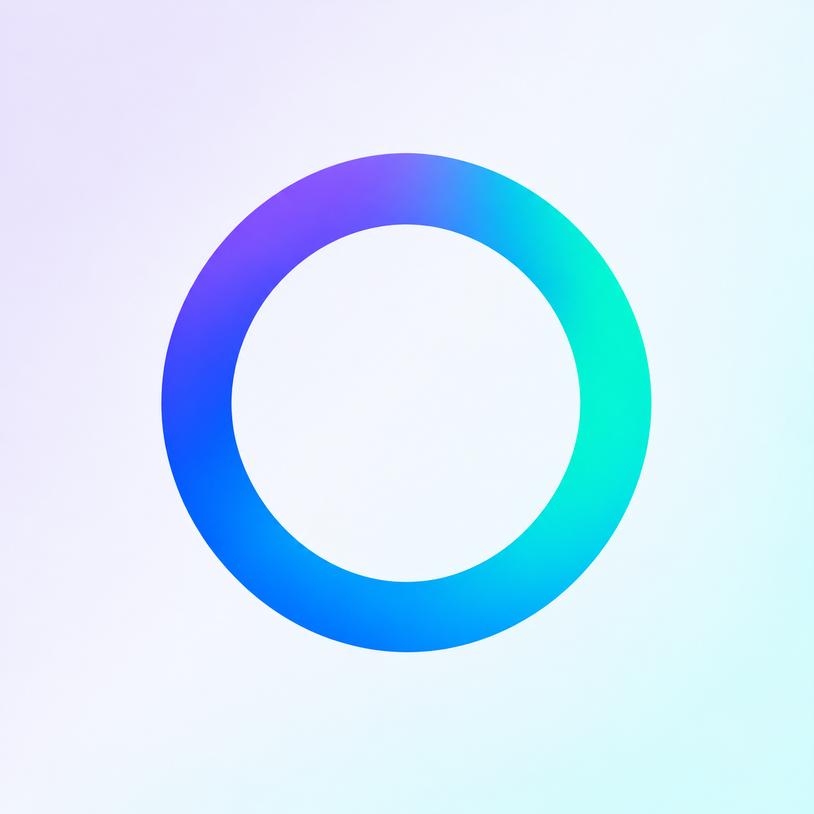
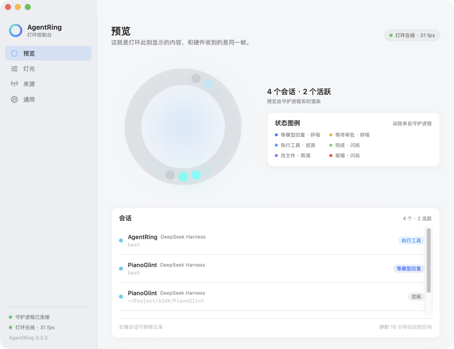

<p align="center"></p>

# AgentRing

[中文](README.md) · [English](README.en.md) · [Website](https://ainx.ink/agentring/)

Turn the live state of the AI agents on your Mac into a visual signal on a ring
of 24 WS2812B LEDs.

AgentRing is a small local-first tool: a resident daemon collects the state of
Codex / DeepSeek Harness / Claude Code, does the layout, motion and power
calculations on the computer side, then hands a 72-byte RGB frame to the
ESP32-C3 ring and to the macOS menu-bar app that controls it.

Current version **0.4.0** · [Website](https://ainx.ink/agentring/) · [Installation](docs/installation.md) · [Usage](docs/usage.md) · [Changelog](CHANGELOG.md)



The screenshot shows the Chinese interface; switch the app to English in
**General → Language**.

## Features

- **Status at a glance**: waiting for approval, error, editing, running a tool, waiting for the model, done and idle each get their own colour and effect; standby and running share one palette family (mono / neon / sunset / mint / aurora / ember / rainbow), while waiting, done and error always keep their reminder colours.
- **One frame, one truth**: all rendering lives in `daemon/src/frame.mjs`; the app preview reads `/frame` and the ESP32 reads the persistent TCP frame stream on 7802, so both consume the same render result.
- **Native macOS app**: a SwiftUI menu-bar utility; the settings window has four pages — Preview, Lighting, Sources and General — with the live session list in the lower half of Preview.
- **Bilingual**: **General → Language** switches the interface between 中文 and English and follows the system by default; the change takes effect immediately and does not affect the daemon or the ring protocol.
- **Preview matches the ring**: when you audition an effect under **Lighting → States**, the ring shows the same composed frame; leaving the preview restores the live state right away, and a stuck client falls back within 45 seconds.
- **The Sources page checks its own bridge**: it detects whether DeepSeek Harness / Codex / Claude Code are installed and whether the DSH plugin and the Codex / Claude hooks are in place; anything missing can be bridged with one click (a copyable command is offered too). Other tools can still report events to `/ingest`.
- **DSH host plugin**: lifecycle, tool calls, approvals and `ask_user_question` are all reported.
- **Wireless provisioning**: without Wi-Fi the board starts an `AgentRing-XXXX` hotspot; open `192.168.4.1` on a phone to provision; settings are stored in NVS.
- **Reproducible setup**: a launchd service, daemon/plugin/installer tests, an SPM build for the app and Arduino CLI firmware builds.

## Structure

```text
AgentRing/
├── daemon/                 Node.js state machine, renderer, HTTP API, tests
│   ├── bin/agentringd.mjs
│   ├── src/
│   ├── test/
│   └── preview/
├── macos/                  SwiftUI menu bar app (Swift Package Manager)
│   ├── Sources/AgentRing/
│   └── build.sh
├── packages/dsh-plugin/    DeepSeek Harness host plugin
├── firmware/esp32/         ESP32-C3 + 24×WS2812B
├── hardware/               3D-printed enclosure (V2 STL / Blender project)
├── scripts/                launchd / Codex / Claude hook installers
├── docs/                   Installation, usage, architecture, configuration, hardware, development, decisions
└── tools/                  Terminal preview, PNG rendering
```

```text
DSH ──plugin───────┐
                   ├─→ agentringd (0.0.0.0:7801) ─→ TCP stream 7802 (72B @30fps) ─→ ESP32-C3 ─→ 24×WS2812B
Codex ──hooks──────┘         │   (optional, not installed by default)
                             └─→ preview (browser ring preview)
```

## Quick start

### Requirements

macOS 14+, Node.js 22+, the Xcode command line tools; the app icon needs
Python 3 + Pillow (`python3 -m pip install pillow`); firmware flashing needs
Arduino IDE 2.x + esp32 core 3.x. The parts list is in
[Hardware](docs/hardware.md).

```sh
git clone <repo-url> AgentRing
cd AgentRing
npm test                 # daemon + DSH plugin tests, no third-party dependencies
```

### 1. Start the daemon

```sh
npm start                 # foreground, http://127.0.0.1:7801
# or as a background service:
node scripts/install-daemon.mjs

curl -s http://127.0.0.1:7801/health
```

Open `http://127.0.0.1:7801/` in a browser to see the ring in action; the daemon
version, ring frame counters and the current preview are all in `/health`.

### 2. Build and install the macOS app

```sh
./macos/build.sh
cp -R dist/AgentRing.app /Applications/
open /Applications/AgentRing.app
node scripts/install-app.mjs   # optional: start at login
```

The app is a menu-bar utility with no Dock icon. If the menu bar icon is tucked
into the hidden section by Thaw / Bartender / Ice, or if macOS "System Settings →
Menu Bar" has switched it off, allow AgentRing to show there first.

### 3. Install the DSH plugin

```sh
dsh plugin --profile desktop add "$PWD/packages/dsh-plugin"
```

Restart DSH after changing plugin code, or toggle the bundle off and on in
Plugins. The Sources page detects whether DSH itself and the plugin are
installed.

### 4. Connect Codex / Claude Code

Open the **Sources** page in the app and click **Connect** for Codex or Claude
Code; it merges the hooks, keeps existing hooks and backs up the files
automatically. Or run it by hand:

```sh
npm run install:codex     # Codex only
npm run install:claude    # Claude Code only
```

### 5. Compile and flash the firmware

```sh
CLI="/Applications/Arduino IDE.app/Contents/Resources/app/lib/backend/resources/arduino-cli"
FQBN="esp32:esp32:esp32c3:CDCOnBoot=cdc,PartitionScheme=huge_app"
"$CLI" compile --fqbn "$FQBN" firmware/esp32/agentring_ring
"$CLI" upload  -p /dev/cu.usbmodemXXXX --fqbn "$FQBN" firmware/esp32/agentring_ring
```

On first boot the board starts an `AgentRing-XXXX` hotspot; connect from a
phone and open `http://192.168.4.1/` to provision, or type `wifi` on the serial
console at 115200. The ring finds the Mac on the same subnet over
`_agentring._tcp`; set a static `AGENTRING_HOST` in `config.h` if needed.

### 6. Acceptance checks

- at least one “Wired” on the Sources page;
- a running session appears on the Preview page;
- clicking an effect under Lighting → States makes the ring show the same frame;
- `curl /health` reports `streamClients` 1 and a growing `streamFrames`.

See [Installation](docs/installation.md) for the full install, upgrade,
uninstall and troubleshooting flow; see [Usage](docs/usage.md) for the
interface and day-to-day operation.

## Documentation

| Document | What it covers |
|---|---|
| [Installation](docs/installation.md) | Requirements, daemon/app/firmware, connecting agents, upgrade and uninstall, troubleshooting |
| [Usage](docs/usage.md) | The four pages, states and palettes, previews, sources, shortcuts, FAQ |
| [Architecture](docs/architecture.md) | Data flow, state machine, rendering, plugin, app |
| [Configuration and API](docs/configuration.md) | Config keys, palettes/effects, source detection, HTTP endpoints |
| [Hardware](docs/hardware.md) | Wiring, power, provisioning, flashing, troubleshooting |
| [Development](docs/development.md) | Directory conventions, tests, builds, plugin hot reload, release checklist |

## Status and limitations

- Current version 0.4.0; config is v3, and 0.2.x configs are migrated automatically when the daemon starts.
- The primary integration today is DeepSeek Harness; the Codex / Claude Code hooks can be bridged with one click on the Sources page, but are not installed by default. Claude Code's `StopFailure` also drives the error state.
- The daemon has no authentication: only `/frame`, `/health` and the read-only TCP frame stream on `7802` are open to the LAN; the preview, `/state`, `/config` and every write endpoint accept loopback only. Use it on trusted networks only.
- The firmware provisioning hotspot is open by default; set `AP_PASSWORD` in `config.h`.
- The app is ad-hoc signed; distribution needs Developer ID + notarization.
- AgentRing itself holds no `PreventUserIdleSystemSleep`: the app uses an ephemeral URLSession with no cache and no cookies so that polling does not create a CFNetwork power assertion every time. If the Mac still will not sleep, check DSH's `dsh-mac-keep-awake` (`caffeinate`), ToDesk's display-sleep assertion, and `SleepDisabled` in `pmset -g`.
- Brightness and colour of the glowing ring follow the physical LEDs; the app preview adds halo and opacity polish on top.

## Development

```sh
npm test                  # daemon state/render/HTTP + DSH plugin tests
npm run version:check     # VERSION matches every package.json
swift build -c release --package-path macos
```

Read [CONTRIBUTING.md](CONTRIBUTING.md) before submitting. Security issues:
[SECURITY.md](SECURITY.md). Community expectations:
[CODE_OF_CONDUCT.md](CODE_OF_CONDUCT.md).

## License

MIT, see [LICENSE](LICENSE).
