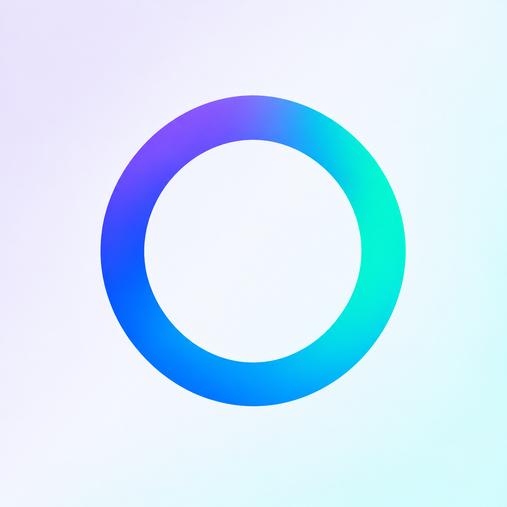
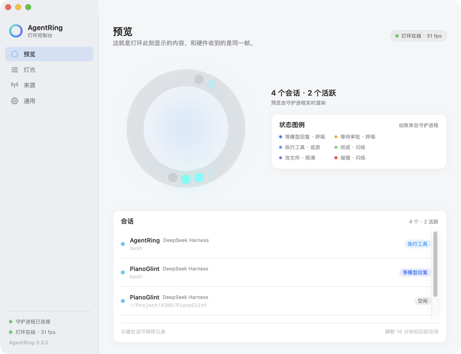

<p align="center"></p>

# AgentRing

把本机 AI agent 的实时状态变成一圈 24 颗 WS2812B 灯珠的视觉信号。

AgentRing 是一个本地优先的小工具：一个常驻 daemon 收集 Codex / DeepSeek Harness /
Claude Code 的状态，在电脑侧完成布局、动效和功耗计算，再把 72 字节的 RGB 帧交给
ESP32-C3 灯环和控制它的 macOS 菜单栏 App。

当前版本 **0.3.0** · [部署指南](docs/installation.md) · [使用说明](docs/usage.md) · [更新日志](CHANGELOG.md)



## 特性

- **一眼可见的状态**：等待审批、报错、改文件、执行工具、等模型、完成、空闲各有颜色和动效；待机与运行共用一套配色（单色 / 霓虹 / 日落 / 薄荷 / 极光 / 暖光 / 彩虹），等待、完成、报错始终保留提醒色。
- **单帧真相**：所有渲染都在 `daemon/src/frame.mjs`；App 预览走 `/frame`，ESP32 走 7802 的持久 TCP 帧流，两者消费同一份渲染结果。
- **原生 macOS App**：SwiftUI 菜单栏工具，设置窗口含预览、灯光、来源、通用四页，实时会话列表并入预览页下半部分。
- **预览即所见**：灯光 → 状态里试听动效时，灯环同步显示同一个合成帧；离开预览立即恢复实时状态，客户端异常也会在 45 秒内回退。
- **来源页会自检接入**：检测 DeepSeek Harness / Codex / Claude Code 的安装状态，以及 DSH 插件、Codex / Claude hooks 是否装好；缺什么就能一键接入（也会给出可复制的命令）。其他工具仍可向 `/ingest` 上报事件。
- **DSH Host 插件**：生命周期、工具调用、审批和 `ask_user_question` 都会上报。
- **无线配网**：没连上 Wi-Fi 时自动开 `AgentRing-XXXX` 热点，手机打开 `192.168.4.1` 即可配网；配置存 NVS。
- **可复现的安装**：launchd 常驻、daemon/插件/安装器测试、SPM 构建 App、Arduino CLI 编译固件。

## 结构

```text
AgentRing/
├── daemon/                 Node.js 状态机、渲染器、HTTP API、测试
│   ├── bin/agentringd.mjs
│   ├── src/
│   ├── test/
│   └── preview/
├── macos/                  SwiftUI 菜单栏 App（Swift Package Manager）
│   ├── Sources/AgentRing/
│   └── build.sh
├── packages/dsh-plugin/    DeepSeek Harness Host 插件
├── firmware/esp32/         ESP32-C3 + 24×WS2812B
├── hardware/               3D 打印外壳（V2 STL / Blender 工程）
├── scripts/                launchd / Codex / Claude hook 安装脚本
├── docs/                   部署、使用、架构、配置、硬件、开发、决策
└── tools/                  终端预览、PNG 渲染
```

```text
DSH ──plugin───────┐
                   ├─→ agentringd (0.0.0.0:7801) ─→ TCP stream 7802 (72B @30fps) ─→ ESP32-C3 ─→ 24×WS2812B
Codex ──hooks──────┘         │   (可选，默认未装)
                             └─→ preview (浏览器圆环预览)
```

## 快速开始

### 环境

macOS 14+、Node.js 22+、Xcode 命令行工具；App 图标需要 Python 3 + Pillow
（`python3 -m pip install pillow`）；刷固件需要 Arduino IDE 2.x + esp32 core 3.x。
硬件清单见[硬件说明](docs/hardware.md)。

```sh
git clone <repo-url> AgentRing
cd AgentRing
npm test                 # daemon + DSH 插件测试，无第三方依赖
```

### 1. 启动 daemon

```sh
npm start                 # 前台，http://127.0.0.1:7801
# 或常驻：
node scripts/install-daemon.mjs

curl -s http://127.0.0.1:7801/health
```

浏览器打开 `http://127.0.0.1:7801/` 可以先看圆环效果；daemon 版本、灯环帧计数和当前
预览都在 `/health` 里。

### 2. 构建并安装 macOS App

```sh
./macos/build.sh
cp -R dist/AgentRing.app /Applications/
open /Applications/AgentRing.app
node scripts/install-app.mjs   # 可选：登录时启动
```

App 是菜单栏工具，没有 Dock 图标。如果菜单栏图标被 Thaw / Bartender / Ice
收进隐藏区，或者 macOS“系统设置 → 菜单栏”里关掉了它，先在那个工具里允许
AgentRing 显示。

### 3. 安装 DSH 插件

```sh
dsh plugin --profile desktop add "$PWD/packages/dsh-plugin"
```

改过插件代码后重启 DSH，或在 Plugins 里把 bundle 关/开一次。来源页会检测 DSH
本体和插件是否装好。

### 4. 接入 Codex / Claude Code

打开 App 的 **来源** 页，对 Codex 或 Claude Code 点 **一键接入**；它会合并 hook、
保留已有 hook 并自动备份。也可以手动执行：

```sh
npm run install:codex     # 仅 Codex
npm run install:claude    # 仅 Claude Code
```

### 5. 编译/刷写固件

```sh
CLI="/Applications/Arduino IDE.app/Contents/Resources/app/lib/backend/resources/arduino-cli"
FQBN="esp32:esp32:esp32c3:CDCOnBoot=cdc,PartitionScheme=huge_app"
"$CLI" compile --fqbn "$FQBN" firmware/esp32/agentring_ring
"$CLI" upload  -p /dev/cu.usbmodemXXXX --fqbn "$FQBN" firmware/esp32/agentring_ring
```

首次启动会开 `AgentRing-XXXX` 热点；手机连上后打开 `http://192.168.4.1/`
配网，也可以串口 115200 输入 `wifi`。灯环通过 `_agentring._tcp` 在同一网段发现
Mac，必要时在 `config.h` 里设置静态 `AGENTRING_HOST`。

### 6. 验收

- 来源页至少一个「已接入」；
- 预览页出现正在运行的会话；
- 灯光 → 状态里点一个效果，灯环同步显示同一帧；
- `curl /health` 的 `streamClients` 为 1、`streamFrames` 持续增长。

完整的安装、升级、卸载和排错见[部署指南](docs/installation.md)；界面和日常操作见
[使用说明](docs/usage.md)。

## 文档

| 文档 | 内容 |
|---|---|
| [部署指南](docs/installation.md) | 环境、daemon/App/固件、agent 接入、升级与卸载、排错 |
| [使用说明](docs/usage.md) | 四个页面、状态与配色、预览、来源、快捷键、常见问题 |
| [架构](docs/architecture.md) | 数据流、状态机、渲染、插件、App |
| [配置与 API](docs/configuration.md) | 配置项、配色/动效、来源检测、HTTP 接口 |
| [硬件](docs/hardware.md) | 接线、供电、配网、烧录、排错 |
| [开发](docs/development.md) | 目录约定、测试、构建、插件热重载、发布清单 |

## 状态与限制

- 当前版本 0.3.0；配置为 v3，0.2.x 的配置会在 daemon 启动时自动迁移。
- 当前主链路是 DeepSeek Harness；Codex / Claude Code 的 hooks 可在来源页一键接入，但默认不安装。Claude Code 的 `StopFailure` 也会驱动报错态。
- daemon 没有鉴权：仅 `/frame`、`/health` 和只读 TCP 帧流 `7802` 对局域网开放；预览、`/state`、`/config` 和所有写接口只接受 loopback。只在可信网络使用。
- 固件配网热点默认开放；可在 `config.h` 设置 `AP_PASSWORD`。
- App 是 ad-hoc 签名；对外分发前需要 Developer ID + 公证。
- AgentRing 自身不持有 `PreventUserIdleSystemSleep`：App 使用无缓存/无 Cookie 的 ephemeral URLSession，避免每次轮询都产生 CFNetwork 电源断言。如果电脑仍不休眠，检查 DSH 的 `dsh-mac-keep-awake`（`caffeinate`）、ToDesk 的显示休眠断言，以及 `pmset -g` 的 `SleepDisabled`。
- 发光环的亮度/颜色以物理灯珠为准，App 预览会额外做光晕和透明度修饰。

## 开发

```sh
npm test                  # daemon 状态/渲染/HTTP + DSH 插件测试
npm run version:check     # VERSION 与各 package.json 一致
swift build -c release --package-path macos
```

提交前请读 [CONTRIBUTING.md](CONTRIBUTING.md)。安全问题见 [SECURITY.md](SECURITY.md)。

## License

MIT，见 [LICENSE](LICENSE)。
