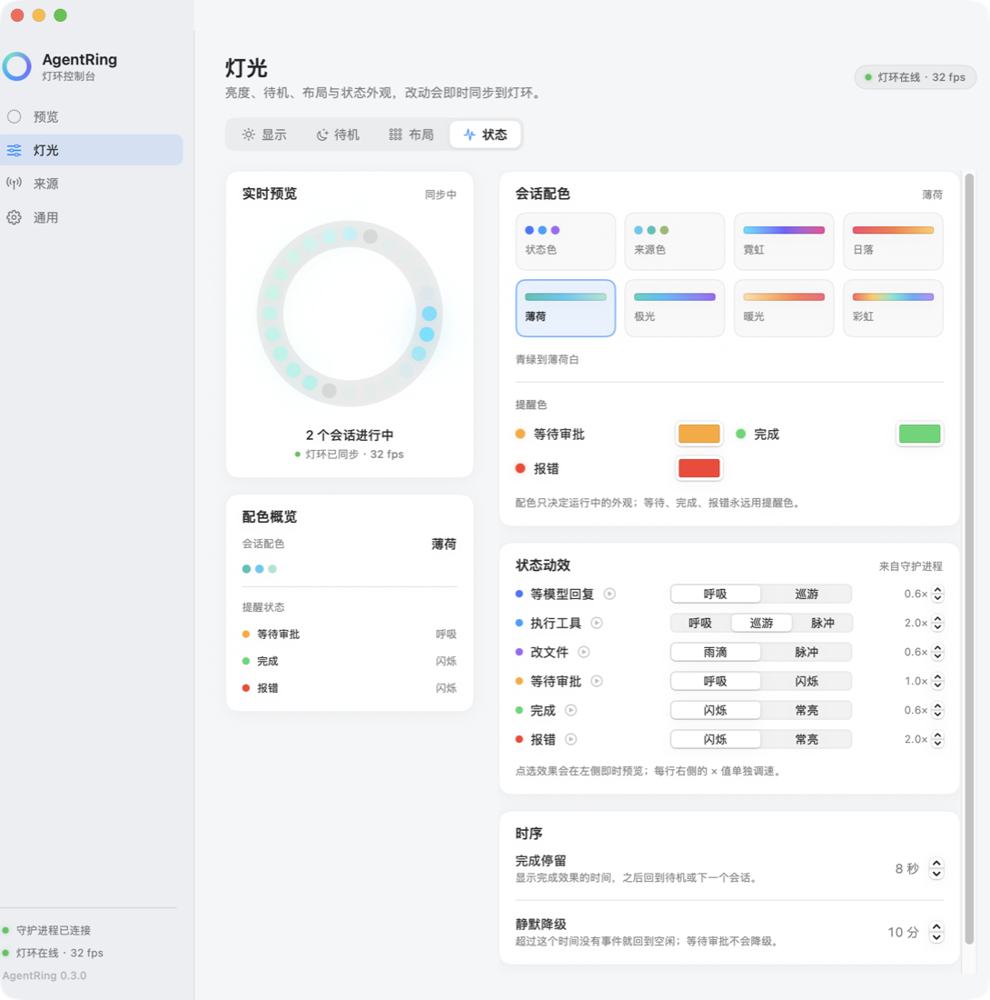
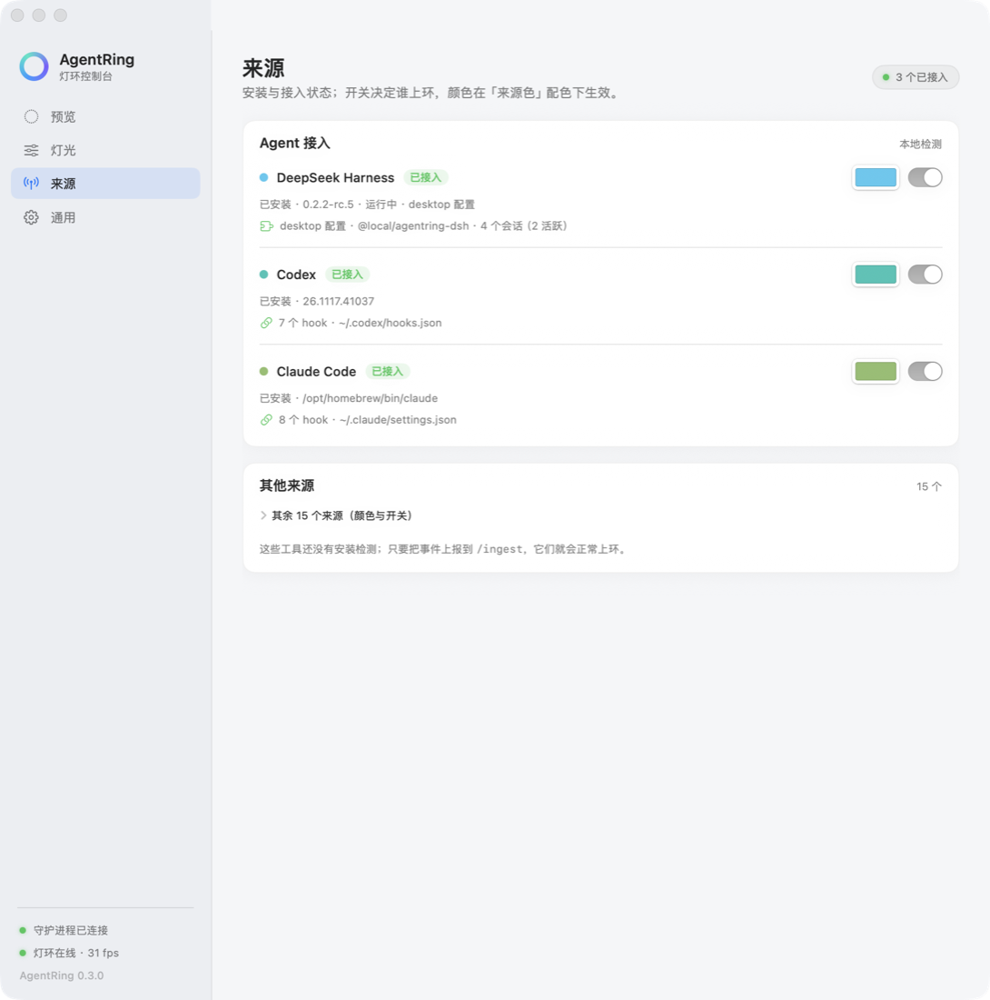
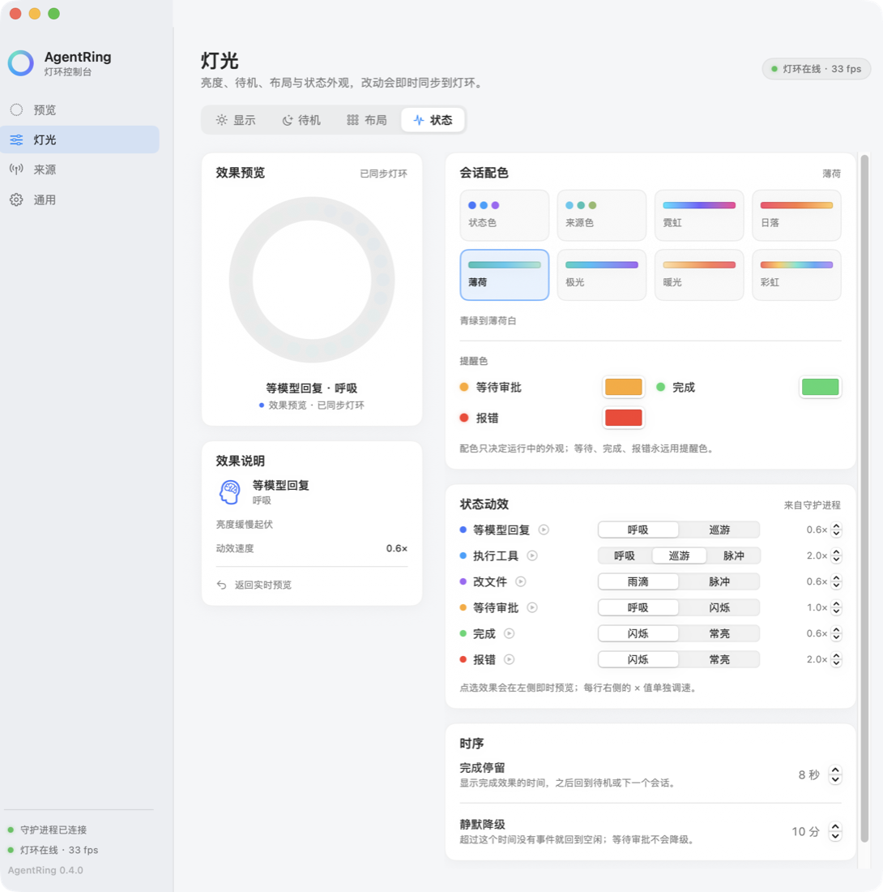

# Configuration and HTTP API

[中文](configuration.zh.md) · [English](configuration.md)

The daemon owns all display behaviour. It stores its state under
`~/.agentring/`:

| Path | Purpose |
|---|---|
| `config.json` | v3 display/layout/motion/source configuration |
| `state.json` | last session snapshot, restored after a daemon restart |
| `daemon.log` | stdout/stderr captured by launchd; capped at 10 MB on start |

## Configuration groups

`POST /config` accepts a partial v3 object; the daemon sanitizes it and writes
the merged result. The macOS app posts the whole object on each edit, and every
field is read as a plain value: there is no “did the caller mean to change this?”
heuristic and no theme that rewrites unrelated fields.

### Display

| Key | Range / values | Default | Notes |
|---|---|---|---|
| `accent` | `state`, `source`, `neon`, `sunset`, `mint`, `aurora`, `ember`, `rainbow` | `state` | Colour of a **running** session; see [Palettes](#palettes) |
| `rainbowSpeed` | 0–2 | 0.35 | Hue travel of the `rainbow` accent |
| `brightness` | 0.05–1.0 | 0.5 | Global after-gamma scale |
| `standby` | `dot`, `orbit`, `breathe` | `dot` | Idle motion while no session is active |
| `standbyPalette` | `mono`, `neon`, `sunset`, `mint`, `aurora`, `ember`, `rainbow` | `mono` | Idle colour; only `mono` uses `standbyColor` |
| `standbySpeed` | 0.2–3.0 | 1.0 | Speed of the standby animation; independent of motion speeds |
| `standbyColor` | `#rrggbb` | `#b4beff` | Colour for the `mono` standby palette |
| `gamma` | 0.8–2.6 | 1.0 | >1 deepens shadows and hardens transitions |
| `currentLimitMa` | 300–2000 | 900 | Frame is scaled down when estimated draw exceeds this |
| `nightMode.enabled` | boolean | false | |
| `nightMode.startMinute` / `endMinute` | 0–1439 | 23:00–07:00 | Minute of day |
| `nightMode.brightness` | 0.02–0.5 | 0.08 | Lower bound inside the window |

### Layout

| Key | Range / values | Default | Notes |
|---|---|---|---|
| `mode` | `split`, `focus`, `rotate` | `split` | |
| `maxAgents` | 1–8 | 4 | More segments than this are hidden |
| `gapLeds` | 0–3 | 1 | Dark LEDs between segments |
| `showIdle` | boolean | false | Whether idle sessions take a segment |
| `rotateSeconds` | 3–60 | 8 | Only used by `rotate` |

### Motion

| Key | Range / values | Default |
|---|---|---|
| `speeds.<state>` | 0.2–3.0 | 1.0 |
| `effects.thinking` | `breathe`, `comet` | `breathe` |
| `effects.tool` | `breathe`, `comet`, `pulse` | `comet` |
| `effects.editing` | `patches`, `pulse` | `patches` |
| `effects.waiting` | `breathe`, `blink` | `breathe` |
| `effects.done` | `flash`, `solid` | `flash` |
| `effects.error` | `blink`, `solid` | `blink` |
| `doneHoldSeconds` | 2–30 | 8 |
| `staleMinutes` | 2–60 | 10 |

`comet` is shown as Orbit and `patches` as Raindrops; `flash` and `blink` both read as
Flash. `solid` (Steady) is kept only for done/error. Effects removed from a state
migrate to that state's current default on load.

Each state has its own `speeds.<state>` multiplier, edited per row in the app's
state table. `display.standbySpeed` is independent: standby does not use the
motion speeds. `doneHoldSeconds` and `staleMinutes` are real seconds/minutes and
are not scaled. The old global `motion.tempo` is gone; a v1 config seeds the
per-state speeds from it once.

### Palettes



One colour vocabulary serves the running ring and the idle ring. A palette is a
**value**, not a macro: selecting one never rewrites colours, speeds or any
other field.

| Id | Label | Kind | Used by | Notes |
|---|---|---|---|---|
| `state` | State colours | identity | accent | Six state wells (`stateColors`) |
| `source` | Source colours | identity | accent | One well per tool (`sources.<name>.color`) |
| `mono` | Mono | identity | standby | The `standbyColor` well |
| `neon` | Neon | ramp | both | Cyan → violet → magenta |
| `sunset` | Sunset | ramp | both | Rose → orange → amber |
| `mint` | Mint | ramp | both | Teal → sky → mint |
| `aurora` | Aurora | ramp | both | Teal → sky → indigo → purple |
| `ember` | Ember | ramp | both | Cream → amber → coral |
| `rainbow` | Rainbow | hue | both | Hue wheel, drifting with time |

**The one rule:** waiting / done / error always use their `stateColors` entry,
whatever the accent is. The accent only decides the “busy” look:

1. With `state`, each running arc uses its state colour.
2. With `source`, each running arc uses its tool colour (a configured hex,
   falling back to the brand colour).
3. With a curated ramp, the stops are spread around the whole ring: an LED at
   ring position `p` gets the ramp colour at `p`, interpolated cyclically so
   there is no seam at twelve o'clock. One agent therefore shows the whole ramp
   across the ring; four agents show four slices of it.
4. With `rainbow`, the hue is the ring position plus
   `time × rainbowSpeed`; it rotates instead of sitting still.

The standby palette reads the same catalogue. `mono` uses the single colour
well; the curated ramps run along the comet tail / around the ring; `rainbow`
drifts with time and `standbySpeed`.

### Colour resolution

For each LED of each selected agent:

```
base   = accent palette (state | source | ramp | rainbow)
colour = waiting / done / error ? stateColors[state] : base
level  = effect(agent.state, localTime)      // per-state effect + speed
out    = colour × level^gamma × brightness    // then power-budget scaling
```

With no selected agent the frame comes from the standby renderer instead, which
keeps exactly one LED lit.

### Migration to v3

v2 split colour across `theme`, `colorMode`, `solidColorBy` and `gradientTo`,
but only one combination reached the LEDs (solid + state ignored the theme
entirely). `loadConfig()` lifts a v2 file with the result that was actually
visible and writes the v3 shape once:

| v2 | v3 |
|---|---|
| `colorMode: "rainbow"` | `accent: "rainbow"` |
| `colorMode: "gradient"` + curated `theme` | `accent: <theme>` (`neon` / `sunset` / `mint`) |
| `colorMode: "gradient"` otherwise | `accent: "state"` or `"source"` |
| `colorMode: "solid"` | `accent: "state"` or `"source"` from `solidColorBy` |
| `theme`, `colorMode`, `gradientTo`, `solidColorBy` | dropped |
| `motion.tempo` | dropped |

`standbyPalette` values `mono` / `rainbow` / `aurora` / `ember` stay valid.
Existing `stateColors` and `sources` are kept. The previous file is not
modified until the first start of the v3 daemon, which rewrites it in place.

## Source detection



`GET /sources` answers two questions per agent tool: is the tool installed, and
is AgentRing connected? Detection is advisory and filesystem-first: it reads
manifests the tool already owns and never invokes the tool's CLI. The daemon
re-probes on every request (the app polls every 10 s), so a plugin installed
outside the app shows up without a daemon restart.

| Tool | Installed when | Bridge | Wired when |
|---|---|---|---|
| `dsh` | `DeepSeek Harness.app` or `~/.dsh` exists | `~/.dsh/profiles/<name>/package.json` lists an `*agentring*` bundle and `node_modules/<name>` resolves | the bundle is also in `dsh.profile.bundles`; the running desktop profile is read from the host process |
| `codex` | `ChatGPT.app`, `~/.codex` or a `codex` CLI exists | `~/.codex/hooks.json` contains AgentRing commands and `~/.agentring/hook.sh` exists | both are present |
| `claude` | `~/.claude` or a `claude` CLI exists | `~/.claude/settings.json` hooks | both are present; the page offers the one-click installer when they are not |

`bridge.state` is one of:

| State | Meaning |
|---|---|
| `installed` | bridge present |
| `missing` | tool present, connection absent; `command` is the installer, and `installable` says whether the daemon can run it |
| `disabled` | package installed but not listed in the profile's bundles |
| `mismatch` | plugin installed in a profile other than the one DSH is running |
| `manual` | protocol supported, no installer registered (reserved for future agents) |

For `codex` and `claude`, the missing state includes `"installable": true`.
`POST /sources/<id>/install` runs only the scripts listed in
`BRIDGE_INSTALLERS`; it never executes the display `command` of a probe. The
installer merges into the tool's config, keeps foreign hooks (including
CodeIsland's), writes a timestamped backup, and is idempotent. DSH's install is a
package-manager command, so it is copy-only. The app shows the one-click button
for installable sources and keeps the copy button as a fallback.

```json
{
  "checkedAt": 1795576755074,
  "entries": [
    {
      "id": "dsh",
      "detected": true,
      "install": {
        "path": "/Applications/DeepSeek Harness.app",
        "version": "0.2.2-rc.5",
        "running": true,
        "profile": "desktop"
      },
      "bridge": {
        "state": "installed",
        "kind": "plugin",
        "detail": "desktop 配置 · @local/agentring-dsh",
        "command": null
      }
    }
  ]
}
```

Limits: the probe cannot see a bundle disabled by a loader patch row
(`disabled: true` in `cordis.patch.yml`), and activity is not part of this
payload — the app joins `/sources` with the sessions from `/state`. A newly
installed hook takes effect on the tool's next session and may require a
one-time trust confirmation in that tool. Adding an agent later means
registering one probe (and, optionally, one installer) in
`daemon/src/sources.mjs`; the page renders whatever the registry reports.

## Effect previews



The States page auditions one state/effect at a time. `POST /preview` with
`{state, effect, ttlMs}` stores a temporary override in the daemon: `/frame`,
the browser preview and the raw TCP stream all serve the synthetic frame, so the
physical ring shows exactly what the app does. The default TTL is 45 s (clamped
to 1 s–10 min); the app refreshes it every 15 s while the preview is open and
sends `DELETE /preview` when the preview closes, the section changes or the
window disappears. An expired override falls back to the live snapshot even if
the client crashed. `GET /preview` remains a one-off frame that does not change
what the ring shows.

## HTTP API

| Method | Path | Description |
|---|---|---|
| GET | `/` | Browser preview (same `/frame` bytes) |
| GET | `/state` | Sessions, active count and timestamps; add `?config=1` to include config |
| GET | `/config` | Full v3 configuration |
| GET | `/capabilities` | Effect and palette IDs, labels, swatches and defaults |
| GET | `/sources` | Install and connection status per registered agent; loopback only |
| POST | `/sources/<id>/install` | Run AgentRing's bridge installer for Codex / Claude; loopback only |
| POST | `/config` | Partial or full v3 update; sanitized and persisted |
| POST | `/config/reset` | Restore the daemon-owned defaults |
| POST | `/ingest` | Unified event: `{source, event, session_id, cwd, tool, kind, message}` |
| POST | `/ingest?source=codex` | Raw Codex/Claude hook payload; mapped by the daemon |
| POST | `/forget` | Remove one session (`{sessionId}`) or all (`{all:true}`) |
| GET | `/frame` | 72 bytes = 24 × RGB, `content-length: 72` (app preview and fallback) |
| GET | `/preview?state=&effect=` | One-off 72-byte synthetic frame; loopback only |
| POST | `/preview` | Mirror `{state, effect, ttlMs}` to the ring until the TTL expires; loopback only |
| DELETE | `/preview` | Drop the preview and restore the live frame; loopback only |
| GET | `/health` | Liveness, daemon version, session count, frame/stream counters and the active preview |
| TCP | `:7802` | Raw frame stream: 72 bytes per tick (~30 fps), one connection |

`/capabilities` returns `{version: 2, standby, accents, standbyPalettes,
effects}`. `accents` and `standbyPalettes` are option lists:

```json
{
  "default": "state",
  "options": [
    { "id": "neon", "label": "霓虹", "kind": "ramp", "blurb": "青蓝到品红",
      "colors": ["#00e5ff", "#7c4dff", "#ff2d95"] }
  ]
}
```

`kind` is `state`, `source`, `mono`, `ramp` or `hue`; the app uses it to decide
whether a tile shows discrete dots or a gradient strip, and whether colour wells
are meaningful.

`/health` also exposes `version`, `preview` (the active preview state or
`null`), `frames`, `lanFrames`, `lanLastFrameAt`,
`lanLastFrameFrom`, `lastFrameFrom`, plus `streamClients`, `streamFrames`,
`streamLastFrameAt` and `streamLastFrameFrom`. The app prefers the stream
counters for ring liveness and falls back to LAN `/frame` counters for older
firmware. `lanFrames` counts `/frame` requests from non-loopback addresses,
which is how the app tells whether the ESP32 is actually polling (the app's own
preview is loopback and does not count).

HTTP routes except `/frame` and `/health` accept loopback connections only,
including the preview, `/state`, `/config`, `/config/reset`, `/sources` and
`/sources/<id>/install`. The daemon binds
`0.0.0.0:7801` for the HTTP API and `0.0.0.0:7802` for the raw frame stream;
there is no authentication or TLS. See [SECURITY.md](../SECURITY.md).

## Persistence

- Configuration is written synchronously on `POST /config`, and once on startup
  when a legacy file is migrated.
- Sessions are serialized to `state.json` 400 ms after an event; heartbeats
  persist at most once a minute. A restart restores sessions from this file.
- The daemon log is truncated on startup when it exceeds 10 MB.

## Tuning notes

The breathing effects bottom out near 3–4% of full scale, and the comet uses a
soft sub-LED head. These are deliberately tuned for an 8-bit WS2812 ring rather
than for a screen preview. Curated ramps use `(j + 0.5) / size` per LED, so a
one-LED arc still lands on the middle of a stop instead of a band edge.
