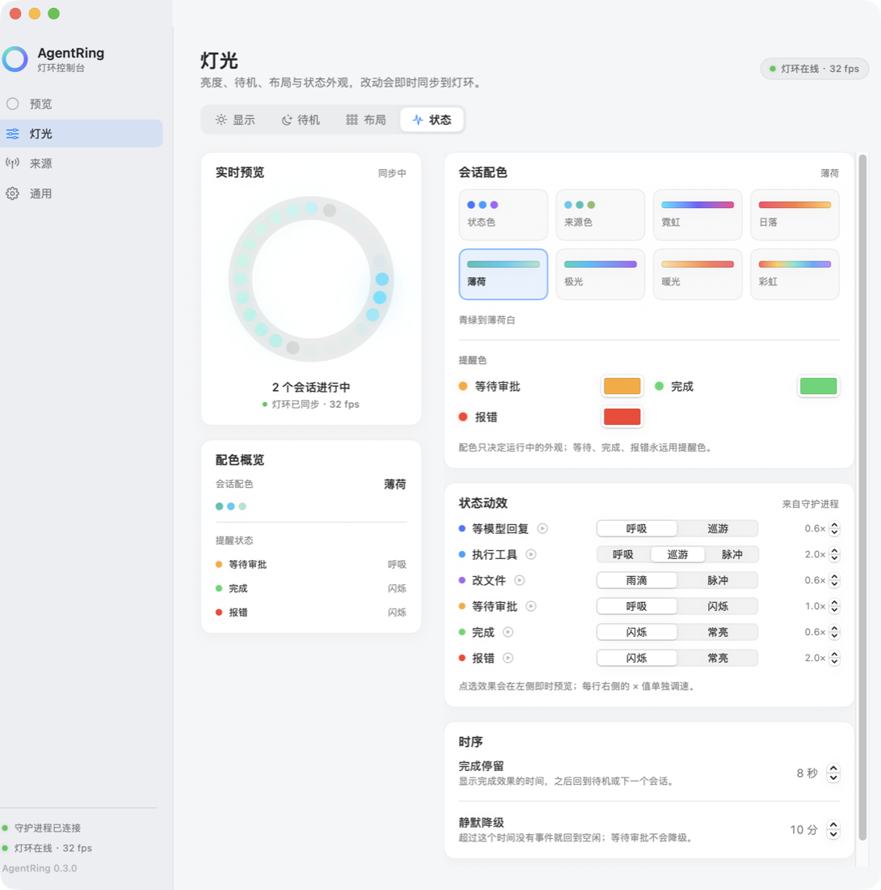
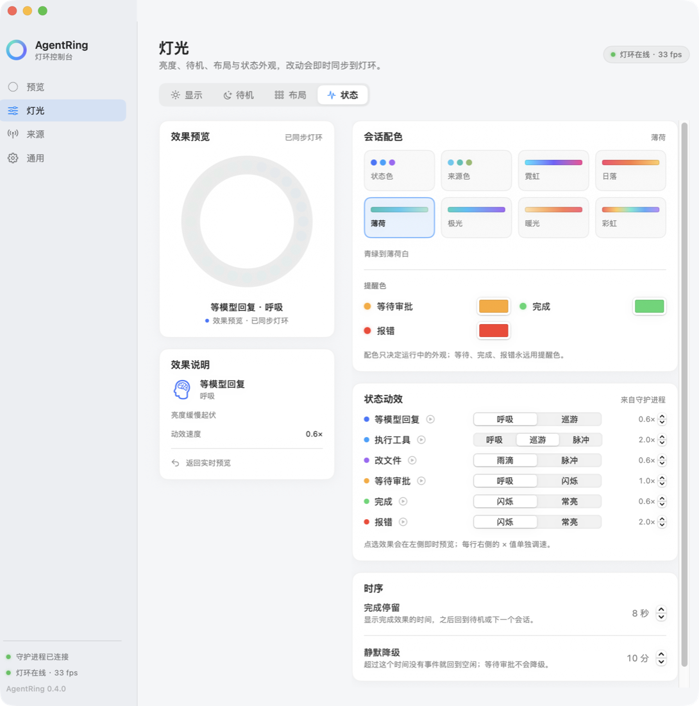

# 配置与 HTTP API

[中文](configuration.zh.md) · [English](configuration.md)

守护进程掌握全部显示行为。它的状态存放在 `~/.agentring/` 下：

| 路径 | 用途 |
|---|---|
| `config.json` | v3 的显示/布局/动效/来源配置 |
| `state.json` | 最近的会话快照，守护进程重启后恢复 |
| `daemon.log` | launchd 捕获的 stdout/stderr；启动时超过 10 MB 会截断 |

## 配置分组

`POST /config` 接受一个 v3 对象的部分字段；守护进程会先做清洗，再写入合并后的结果。macOS App 在每次编辑时提交整个对象，所有字段都按普通值读取：不存在“调用方是不是想改这个字段”的启发式判断，也没有哪种主题会顺带改写无关字段。

### 显示

| 键 | 范围 / 取值 | 默认值 | 说明 |
|---|---|---|---|
| `accent` | `state`, `source`, `neon`, `sunset`, `mint`, `aurora`, `ember`, `rainbow` | `state` | **运行中**会话的颜色；见[配色](#配色) |
| `rainbowSpeed` | 0–2 | 0.35 | `rainbow` 配色的色相流动速度 |
| `brightness` | 0.05–1.0 | 0.5 | 伽马之后的全局缩放 |
| `standby` | `dot`, `orbit`, `breathe` | `dot` | 没有活跃会话时的空闲动效 |
| `standbyPalette` | `mono`, `neon`, `sunset`, `mint`, `aurora`, `ember`, `rainbow` | `mono` | 待机颜色；只有 `mono` 使用 `standbyColor` |
| `standbySpeed` | 0.2–3.0 | 1.0 | 待机动画速度；与动效速度相互独立 |
| `standbyColor` | `#rrggbb` | `#b4beff` | `mono` 待机配色使用的颜色 |
| `gamma` | 0.8–2.6 | 1.0 | >1 会加深阴影、让过渡更硬 |
| `currentLimitMa` | 300–2000 | 900 | 估算电流超过该电流上限时整帧按比例压暗 |
| `nightMode.enabled` | boolean | false | |
| `nightMode.startMinute` / `endMinute` | 0–1439 | 23:00–07:00 | 一天中的分钟数 |
| `nightMode.brightness` | 0.02–0.5 | 0.08 | 时间窗口内的亮度上限 |

### 布局

| 键 | 范围 / 取值 | 默认值 | 说明 |
|---|---|---|---|
| `mode` | `split`, `focus`, `rotate` | `split` | |
| `maxAgents` | 1–8 | 4 | 超过这个数量的分段会被隐藏 |
| `gapLeds` | 0–3 | 1 | 分段之间的暗灯珠 |
| `showIdle` | boolean | false | 空闲会话是否占用分段 |
| `rotateSeconds` | 3–60 | 8 | 仅 `rotate` 使用 |

### 动效

| 键 | 范围 / 取值 | 默认值 |
|---|---|---|
| `speeds.<state>` | 0.2–3.0 | 1.0 |
| `effects.thinking` | `breathe`, `comet` | `breathe` |
| `effects.tool` | `breathe`, `comet`, `pulse` | `comet` |
| `effects.editing` | `patches`, `pulse` | `patches` |
| `effects.waiting` | `breathe`, `blink` | `breathe` |
| `effects.done` | `flash`, `solid` | `flash` |
| `effects.error` | `blink`, `solid` | `blink` |
| `doneHoldSeconds` | 2–30 | 8 |
| `staleMinutes` | 2–60 | 10 |

`comet` 在界面上显示为「巡游」，`patches` 显示为「雨滴」；`flash` 和 `blink` 都读作「闪烁」。`solid`（常亮）只为完成/报错保留。加载配置时，某个状态已移除的动效会迁移为该状态当前的默认值。

每个状态都有自己的 `speeds.<state>` 倍率，在 App 的状态表里逐行编辑。`display.standbySpeed` 独立存在：待机不使用动效速度。`doneHoldSeconds` 和 `staleMinutes` 是真实的秒/分钟，不做缩放。旧的全局 `motion.tempo` 已移除；v1 配置会由它一次性初始化各状态的速度。

### 配色



运行中的灯环和待机灯环共用一套颜色词汇。配色是一个**值**，不是宏：选择某个配色永远不会改写颜色、速度或其他任何字段。

| ID | 名称 | 类型 | 使用者 | 说明 |
|---|---|---|---|---|
| `state` | 状态色 | 身份型 | 会话配色 | 六个状态取色器（`stateColors`） |
| `source` | 来源色 | 身份型 | 会话配色 | 每个工具一个取色器（`sources.<name>.color`） |
| `mono` | 单色 | 身份型 | 待机 | `standbyColor` 取色器 |
| `neon` | 霓虹 | 渐变 | 两者 | 青 → 紫 → 品红 |
| `sunset` | 日落 | 渐变 | 两者 | 玫瑰 → 橙 → 琥珀 |
| `mint` | 薄荷 | 渐变 | 两者 | 青绿 → 天蓝 → 薄荷 |
| `aurora` | 极光 | 渐变 | 两者 | 青绿 → 天蓝 → 靛蓝 → 紫 |
| `ember` | 暖光 | 渐变 | 两者 | 奶油 → 琥珀 → 珊瑚 |
| `rainbow` | 彩虹 | 色相 | 两者 | 色轮，随时间漂移 |

**唯一的规则：** 无论会话配色是什么，等待审批 / 完成 / 报错始终使用 `stateColors` 中对应的颜色。会话配色只决定“忙碌”外观：

1. 用 `state` 时，每段运行中的弧线使用各自的状态色。
2. 用 `source` 时，每段运行中的弧线使用该工具的颜色（配置的十六进制色，缺失时回退到品牌色）。
3. 用精选渐变时，各个色标会在整个灯环上铺开：灯环位置 `p` 处的灯珠取渐变在 `p` 处的颜色，并按环形循环插值，因此十二点方向没有接缝。所以一个 agent 会在整个灯环上显示整段渐变；四个 agent 则各显示其中一段。
4. 用 `rainbow` 时，色相等于灯环位置加上 `time × rainbowSpeed`；它会旋转，而不是静止不动。

待机配色读取同一套目录。`mono` 使用单个取色器；精选渐变沿 comet 尾部、环绕灯环展开；`rainbow` 随时间与 `standbySpeed` 漂移。

### 颜色解析

对每个被选中 agent 的每颗灯珠：

```
base   = accent palette (state | source | ramp | rainbow)
colour = waiting / done / error ? stateColors[state] : base
level  = effect(agent.state, localTime)      // per-state effect + speed
out    = colour × level^gamma × brightness    // then power-budget scaling
```

没有选中任何 agent 时，帧改由待机渲染器生成，它只点亮一颗灯珠。

### 迁移到 v3

v2 把颜色拆散在 `theme`、`colorMode`、`solidColorBy` 和 `gradientTo` 里，但只有一种组合真正到达过灯珠（solid + state 完全忽略了主题）。`loadConfig()` 会按当时实际可见的结果提升 v2 文件，并一次性写入 v3 结构：

| v2 | v3 |
|---|---|
| `colorMode: "rainbow"` | `accent: "rainbow"` |
| `colorMode: "gradient"` + 精选 `theme` | `accent: <theme>` (`neon` / `sunset` / `mint`) |
| `colorMode: "gradient"` 的其他情况 | `accent: "state"` 或 `"source"` |
| `colorMode: "solid"` | 由 `solidColorBy` 决定 `accent: "state"` 或 `"source"` |
| `theme`、`colorMode`、`gradientTo`、`solidColorBy` | 移除 |
| `motion.tempo` | 移除 |

`standbyPalette` 的 `mono` / `rainbow` / `aurora` / `ember` 取值仍然有效。已有的 `stateColors` 和 `sources` 会保留。旧文件在 v3 守护进程首次启动前不会被修改，首次启动时会就地重写。

## 来源检测


`GET /sources` 会针对每个 agent 工具回答两个问题：工具是否已安装，以及 AgentRing 是否已接入。检测结果仅供参考，并且以文件系统为先：只读取工具自己已经维护的清单文件，从不调用工具的 CLI。守护进程在每次请求时重新探测（App 每 10 秒轮询一次），因此装在 App 之外的插件无需重启守护进程就能显示出来。

| 工具 | 何时视为已安装 | 接入 | 何时视为已接入 |
|---|---|---|---|
| `dsh` | 存在 `DeepSeek Harness.app` 或 `~/.dsh` | `~/.dsh/profiles/<name>/package.json` 中列出了 `*agentring*` bundle，且 `node_modules/<name>` 可解析 | 该 bundle 同时出现在 `dsh.profile.bundles` 中；运行中的桌面 profile 从宿主进程读取 |
| `codex` | 存在 `ChatGPT.app`、`~/.codex` 或 `codex` CLI | `~/.codex/hooks.json` 包含 AgentRing 命令，且 `~/.agentring/hook.sh` 存在 | 两者都存在 |
| `claude` | 存在 `~/.claude` 或 `claude` CLI | `~/.claude/settings.json` 的 hooks | 两者都存在；不存在时页面会提供一键接入安装器 |

`bridge.state` 的取值：

| 状态 | 含义 |
|---|---|
| `installed` | 接入已存在 |
| `missing` | 工具已安装但缺少连接；`command` 是安装器，`installable` 表示守护进程能否运行它 |
| `disabled` | 包已安装，但没有列在 profile 的 bundles 中 |
| `mismatch` | 插件装在 DSH 当前运行 profile 之外的 profile 里 |
| `manual` | 支持该协议，但没有注册安装器（预留给未来的 agent） |

对 `codex` 和 `claude`，`missing` 状态会包含 `"installable": true`。`POST /sources/<id>/install` 只运行 `BRIDGE_INSTALLERS` 中列出的脚本；它永远不会执行探针的展示 `command`。安装器会把 hook 合并进工具的配置，保留其他 hook（包括 CodeIsland 的），写入带时间戳的备份，并且是幂等的。DSH 的安装是一条包管理器命令，所以只能复制。App 对可安装的来源显示一键接入按钮，并保留复制按钮作为回退。

```json
{
  "checkedAt": 1795576755074,
  "entries": [
    {
      "id": "dsh",
      "detected": true,
      "install": {
        "path": "/Applications/DeepSeek Harness.app",
        "version": "0.2.2-rc.5",
        "running": true,
        "profile": "desktop"
      },
      "bridge": {
        "state": "installed",
        "kind": "plugin",
        "detail": "desktop 配置 · @local/agentring-dsh",
        "command": null
      }
    }
  ]
}
```

限制：探针看不到被 loader patch 条目禁用的 bundle（`cordis.patch.yml` 中的 `disabled: true`），活动状态也不在这份返回里——App 会把 `/sources` 与 `/state` 的会话合并。新安装的 hook 在工具的下一个会话生效，可能还需要在该工具里做一次性的信任确认。以后新增 agent，只需在 `daemon/src/sources.mjs` 里注册一个探针（以及可选的安装器）；页面会渲染注册表报告的内容。

## 效果预览



「状态」页一次只试听一个 state/effect。带 `{state, effect, ttlMs}` 的 `POST /preview` 会在守护进程里存下一份临时覆盖：`/frame`、浏览器预览和原始 TCP 帧流都会输出合成帧，所以物理灯环显示的效果与 App 完全一致。默认 TTL 为 45 秒（限制在 1 秒–10 分钟）；预览打开期间 App 每 15 秒续期一次，并在预览关闭、切换分区或窗口消失时发送 `DELETE /preview`。即使客户端崩溃，过期的覆盖也会自动回退到实时快照。`GET /preview` 仍然只生成一帧一次性画面，不改变灯环显示的内容。

## HTTP API

| 方法 | 路径 | 说明 |
|---|---|---|
| GET | `/` | 浏览器预览（与 `/frame` 相同的字节） |
| GET | `/state` | 会话、活跃计数和时间戳；加 `?config=1` 会带上配置 |
| GET | `/config` | 完整的 v3 配置 |
| GET | `/capabilities` | 动效与配色的 ID、名称、色块和默认值 |
| GET | `/sources` | 每个已注册 agent 的安装与接入状态；仅限 loopback |
| POST | `/sources/<id>/install` | 为 Codex / Claude 运行 AgentRing 的接入安装器；仅限 loopback |
| POST | `/config` | 提交部分或完整 v3 更新；清洗后持久化 |
| POST | `/config/reset` | 恢复守护进程自带的默认值 |
| POST | `/ingest` | 统一事件：`{source, event, session_id, cwd, tool, kind, message}` |
| POST | `/ingest?source=codex` | 原始的 Codex/Claude hook 载荷；由守护进程映射 |
| POST | `/forget` | 删除一个会话（`{sessionId}`）或全部会话（`{all:true}`） |
| GET | `/frame` | 72 字节 = 24 × RGB，`content-length: 72`（App 预览与回退） |
| GET | `/preview?state=&effect=` | 一帧一次性的 72 字节合成帧；仅限 loopback |
| POST | `/preview` | 把 `{state, effect, ttlMs}` 镜像到灯环，直到 TTL 过期；仅限 loopback |
| DELETE | `/preview` | 丢弃预览并恢复实时帧；仅限 loopback |
| GET | `/health` | 存活状态、守护进程版本、会话数、帧/流计数以及当前预览 |
| TCP | `:7802` | 原始帧流：每个 tick 72 字节（约 30 fps），单连接 |

`/capabilities` 返回 `{version: 2, standby, accents, standbyPalettes, effects}`。`accents` 和 `standbyPalettes` 是选项列表：

```json
{
  "default": "state",
  "options": [
    { "id": "neon", "label": "霓虹", "kind": "ramp", "blurb": "青蓝到品红",
      "colors": ["#00e5ff", "#7c4dff", "#ff2d95"] }
  ]
}
```

`kind` 取值为 `state`、`source`、`mono`、`ramp` 或 `hue`；App 用它决定一个选项显示为离散圆点还是渐变条，以及取色器是否有意义。

`/health` 还会返回 `version`、`preview`（当前生效的预览状态或 `null`）、`frames`、`lanFrames`、`lanLastFrameAt`、`lanLastFrameFrom`、`lastFrameFrom`，以及 `streamClients`、`streamFrames`、`streamLastFrameAt` 和 `streamLastFrameFrom`。App 优先用流计数判断灯环是否在线，遇到旧固件时回退到局域网 `/frame` 计数。`lanFrames` 统计来自非 loopback 地址的 `/frame` 请求，App 借此判断 ESP32 是否真的在轮询（App 自己的预览是 loopback，不计入）。

除 `/frame` 和 `/health` 之外，HTTP 路由只接受 loopback 连接，包括预览、`/state`、`/config`、`/config/reset`、`/sources` 和 `/sources/<id>/install`。守护进程在 `0.0.0.0:7801` 上提供 HTTP API，在 `0.0.0.0:7802` 上提供原始帧流；没有鉴权，也没有 TLS。见 [SECURITY.zh.md](../SECURITY.zh.md)。

## 持久化

- 配置在 `POST /config` 时同步写入；启动时如果迁移了旧版文件，也会写入一次。
- 会话在事件发生 400 毫秒后序列化到 `state.json`；心跳最多每分钟持久化一次。重启后会从该文件恢复会话。
- 守护进程日志超过 10 MB 时会在启动时截断。

## 调校说明

呼吸类动效最低会降到满量程的 3–4% 左右，comet 使用柔和的亚灯珠头部。这些参数是刻意按 8 位 WS2812 灯环调校的，而不是按屏幕预览。精选渐变对每颗灯珠使用 `(j + 0.5) / size`，因此只有一颗灯珠的弧线也会落在色标中间，而不是色带边缘。
