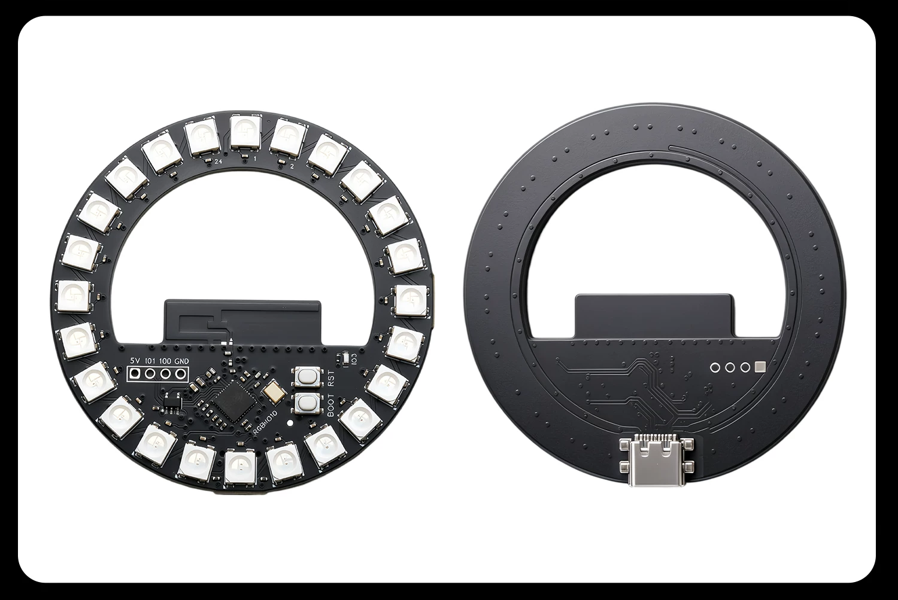

# 硬件

[中文](hardware.zh.md) · [English](hardware.md)

完整的部署流程（守护进程、App、hook、配网和验收）见[部署指南](installation.zh.md)。

## 照片



24 颗 WS2812B 灯环、ESP32-C3 板与 USB-C 接口：灯珠面与背面。
更多：[竖排正反面](../hardware/photos/ring-front-back-vertical.webp) ·
[PCB 尺寸标注](../hardware/photos/ring-dimensions.webp)。

## 物料清单

- ESP32-C3 开发板（已验证 4 MB Flash；原生 USB-Serial/JTAG）。
- 24 颗 WS2812B 灯环，5 V。
- 灯环用 5 V / 2 A 电源（**不要**用 3.3 V 给灯环供电）。
- DIN 串联 330 Ω 电阻；建议用 74AHCT125 做 3.3 V → 5 V 电平转换。
- 灯环电源两端并 1000 µF 电解电容 + 0.1 µF 陶瓷电容；共地。

## 接线

| 信号 | 连接 |
|---|---|
| 灯环 DIN | ESP32-C3 的 **GPIO10** |
| 板载 LED | GPIO3（当前未驱动） |
| 灯环 5V | 外接 5 V 电源正极 |
| 灯环 GND | 电源负极 + ESP32 GND |
| 灯环 DOUT | 单条 24 灯珠灯环不接 |

避开 strapping 引脚 GPIO2/8/9 和 USB 引脚 GPIO18/19。本版本用 GPIO10 作为数据脚；
如果你的板子不同，改 `config.h` 里的 `LED_GPIO`。

## 固件结构

```text
firmware/esp32/agentring_ring/
├── agentring_ring.ino   setup/loop, provisioning, portal routes, serial commands
├── leds.h / leds.cpp    RMT WS2812B output and offline/config fallbacks
├── portal_ui.h/.cpp     captive-portal HTML
├── ring_client.h/.cpp   mDNS discovery and raw TCP frame stream
└── config.h             optional compile-time Wi-Fi, static host, GPIO, timing
```

Wi-Fi 在运行时配置，不编译进固件：

- 启动时从 NVS 读取凭据。如果没有凭据，或者保存的网络连不上，设备会开一个名为
  `AgentRing-XXXX`（MAC 末四位）的 SoftAP，并在 `http://192.168.4.1/` 提供配网页面。
- 配网页面会扫描 2.4 GHz 网络，可以按编号选择，也可以手动输入隐藏 SSID；保存凭据后
  关闭热点。
- 串口后备配置，115200 波特率：

```text
wifi            serial provisioning
wifi portal     start the SoftAP again
wifi status     show SSID / IP / RSSI / MAC
wifi clear      erase saved Wi-Fi
info            LED pin/count, frame interval, Wi-Fi state, portal URL
reboot
```

`config.h` 仍支持 `WIFI_SSID` / `WIFI_PASS` 作为编译期后备；正常流程请留空。
`AP_PASSWORD` 留空表示配网热点无密码；需要密码就填上。

## 编译与烧录

使用 Arduino IDE 2.x（**esp32 by Espressif 3.x**），或 IDE 自带的 CLI：

```sh
CLI="/Applications/Arduino IDE.app/Contents/Resources/app/lib/backend/resources/arduino-cli"
FQBN="esp32:esp32:esp32c3:CDCOnBoot=cdc,PartitionScheme=huge_app"

"$CLI" compile --fqbn "$FQBN" firmware/esp32/agentring_ring
"$CLI" upload -p /dev/cu.usbmodemXXXX --fqbn "$FQBN" firmware/esp32/agentring_ring
```

- 原生 USB 口上的 `Serial` 需要 **USB CDC On Boot: Enabled**。
- **Huge APP (3 MB No OTA)** 让固件只占约 35% 的 Flash。
- 板子会自动复位进 ROM 引导程序；如果上传卡在“Connecting…”，按住 BOOT 再点一下 RST。
- `Serial` 为 115200。启动横幅会打印 `LED: GPIO10 x24, frame 33ms`。

## 排错

| 现象 | 检查 |
|---|---|
| 灯环不亮 | 5 V 电源、共地、DIN 是否在 GPIO10、330 Ω 电阻，以及串口 `info` |
| 灯环一直是蓝色呼吸，不显示 agent 颜色 | `curl http://<mac>:7801/health` —— `streamClients` 应为 1，`streamFrames` 应约 30/s 增长；防火墙要放行 TCP 7802 |
| 换了 Mac 的位置后灯环找不到 | mDNS 会选同网段的 IPv4；如果 Mac 换了网络，用 `AGENTRING_HOST` 指定一个静态主机地址 |
| 配网页面没有弹出 | 连到 `AgentRing-XXXX`，手动打开 `http://192.168.4.1/` |
| 烧录找不到板子 | 重插 USB；换数据线；检查 `/dev/cu.usbmodem*` |
| 颜色看起来是红绿互换的 | 确认 RGB → GRB 转换；代码对 WS2812B 用的是 GRB |
| 守护进程重启后灯环卡住 | 固件会因一次短读断开帧流并自动重连；在 `/health` 里确认 `streamClients=1` 且 `streamFrames` 在增长 |
| 灯环卡顿或闪烁 | 先确认 `streamClients=1`、`streamFrames` ≈30/s；帧流稳定的情况下，检查 5 V 电源/地、330 Ω 数据电阻和电平转换，也可以调低 `currentLimitMa` |

## 外壳

灯环和 ESP32-C3 板子的可打印外壳在 [`hardware/enclosure/`](../hardware/enclosure/)：
每个版本三个 STL、Blender 源文件、预览渲染图和打印/装配说明。版本概览见
[hardware/README.zh.md](../hardware/README.zh.md)。

## 安全

灯环全白时电流约 1.44 A。请用独立的 5 V 电源，保持 ESP32 与灯环共地，绝不要用
3.3 V 给 24 颗灯珠供电。
