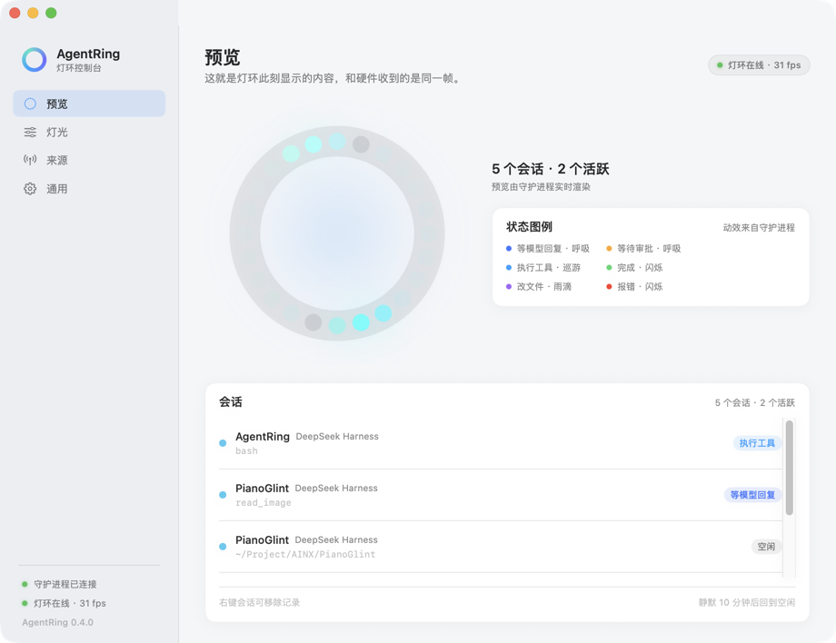
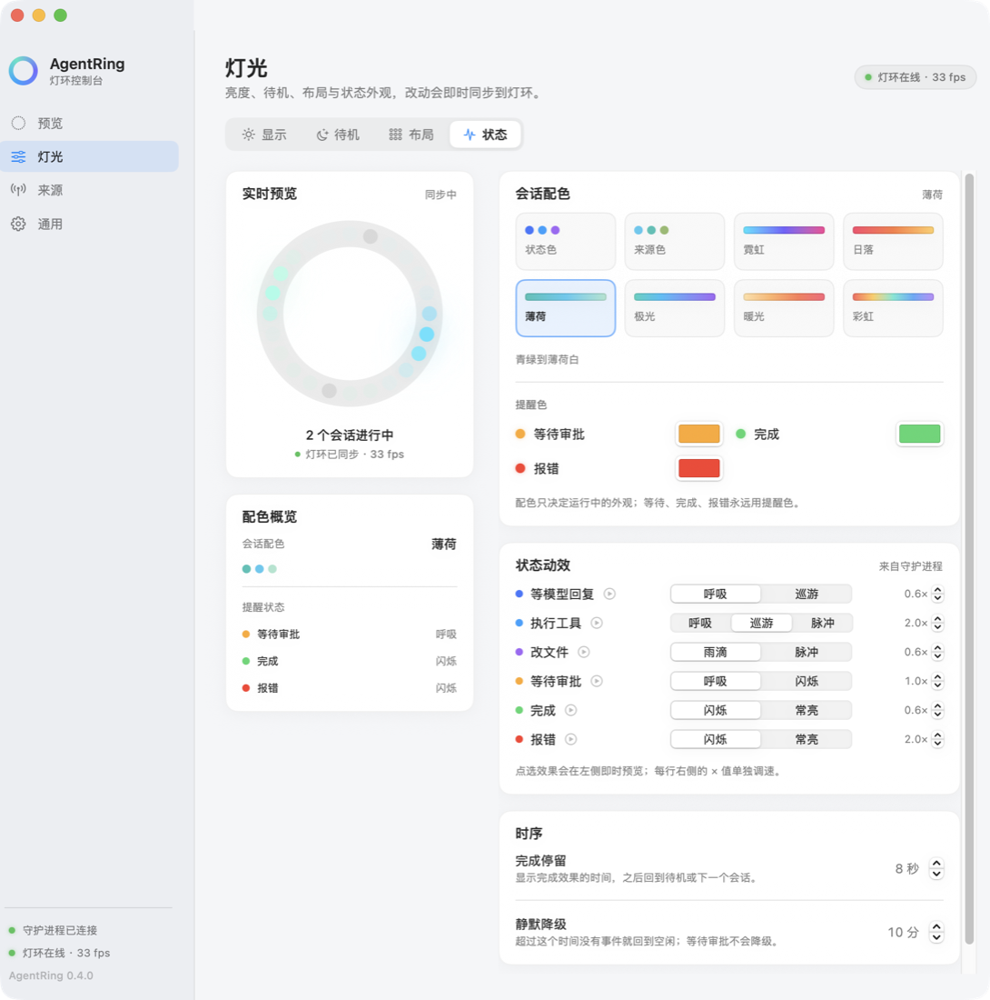
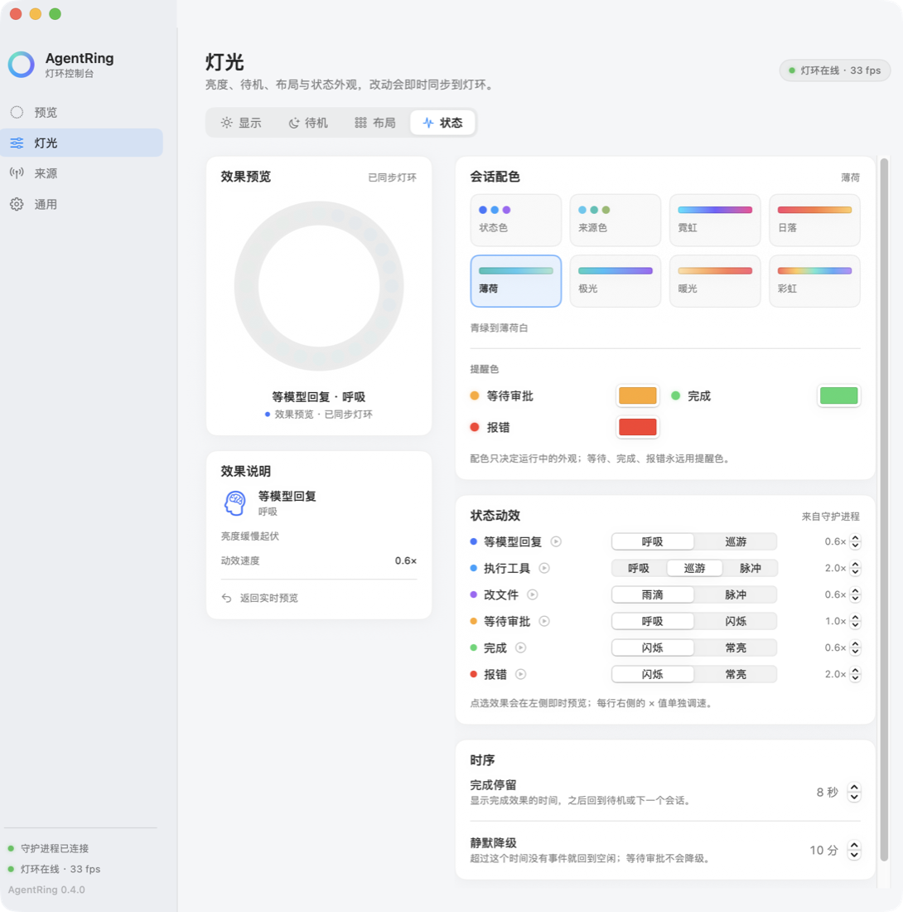

# Using AgentRing

This guide covers the app and the ring from day to day. For installation see
[Installation](installation.md); for every config key and HTTP route see
[Configuration](configuration.md).

## Menu bar

AgentRing is a menu-bar utility with no Dock icon. The item shows:

- the number of sessions that are not idle;
- a raised-hand icon when a session is waiting for approval;
- a warning triangle when a session is in error.

Its menu opens the settings window (`⌘,`), lists up to five sessions with their
state, restarts the daemon, opens the browser preview, and quits the app. A
clean quit is not relaunched by launchd; a crash is.

## The settings window

Four pages, switchable with `⌘1`–`⌘4`:

| Page | Shortcut | What it is for |
|---|---|---|
| 预览 | `⌘1` | What the ring is showing right now, plus the session list |
| 灯光 | `⌘2` | Brightness, standby, layout and per-state appearance |
| 来源 | `⌘3` | Which agents are installed, connected and shown |
| 通用 | `⌘4` | Daemon/ring diagnostics, maintenance and versions |

The sidebar footer always shows whether the daemon is connected and whether the
physical ring is receiving frames.

### 预览

The ring hero is rendered from the daemon's `/frame` bytes — the same bytes the
ESP32 receives. Below it you get:

- the session count and active count;
- attention chips when sessions are waiting or in error;
- a legend of the six states and their current effects;
- the live session list, where each row shows label, source, state and tool.

Right-click a session to remove a stale record. The footer shows the silence
timeout that returns a quiet session to idle. Sessions are ordered by urgency:
`waiting > error > editing > tool > thinking > done > idle`.

### 灯光

A live ring rail on the left, controls on the right. The rail's overview card
follows the selected section.

**显示**

- **亮度**: global output scale (5–100%).
- **伽马**: 1.0 preserves the renderer's levels; higher values deepen shadows
  and harden fades.
- **电流上限**: the renderer scales the whole frame down when the estimated
  WS2812 current exceeds this budget (300–2000 mA). 24 LEDs at full white draw
  about 1.44 A.
- **夜间模式**: a local-time window that caps brightness at a lower value.

**待机**

What one LED does when no session is running:

| Mode | Behaviour |
|---|---|
| 常亮单点 | A still dim LED |
| 巡游 | A short comet slowly circles the ring |
| 随机呼吸 | A randomly placed LED fades in and out, overlapping the next |

The standby palette is independent of the session palette: **单色** uses the
colour well below, while **霓虹 / 日落 / 薄荷 / 极光 / 暖光 / 彩虹** are curated.
Standby speed (0.2–3×) only affects standby, not the session effects. Night mode
also applies to standby.

**布局**

How sessions share the ring:

- **等分**: one segment per session.
- **聚焦最紧急**: only the most urgent session is shown.
- **轮播**: one session at a time, changing every 3–60 seconds.

`最多分段` (1–8), `分段间隔` (0–3 dark LEDs), and `空闲会话也占一段` control how
the ring is divided. Idle sessions are hidden unless that toggle is on.

**状态**

This is where colour and motion meet. One accent palette, then one row per
state:

- **会话配色**: 状态色 / 来源色 / 霓虹 / 日落 / 薄荷 / 极光 / 暖光 / 彩虹.
  It decides the **running** look only.
- **状态色** (for 状态色): the six state wells. The first three are the running
  colours; the last three are also the reminder colours.
- **提醒色** (for any other accent): the three colours used by waiting, done and
  error. They are never overridden by the accent.
- **状态动效**: effect + speed (0.2–3×) per state. Click the state name or pick
  an effect to audition it; see previews below.
- **时序**: how long the done flash is held (2–30 s) and how long a silent
  session may run before it degrades to idle (2–60 min). Waiting is exempt from
  the silence timeout.

The one rule to remember: **waiting / done / error always use their reminder
colours**, whatever the accent is. The accent only changes the busy look.

#### Effect previews on the ring

When you audition an effect in 状态, the physical ring shows the same synthetic
frame: the daemon holds a temporary preview override and serves it on `/frame`
and the TCP stream. The rail reads `/frame` too, so the screen and the ring
cannot disagree. The card then says “效果预览 · 已同步灯环”.

- The preview is refreshed every 15 s while the page is open and expires after
  45 s.
- **返回实时预览**, changing the lighting section, or closing the settings
  window clears it immediately.
- While a preview is active the ring shows that state instead of the live
  sessions; leaving the preview restores them.
- If the app crashes or is killed, the preview expires within 45 s.

### 来源

One row per supported agent, with an installation and connection status:

| Status | Meaning |
|---|---|
| 已接入 | The tool and its AgentRing bridge are present |
| 未接入 | The tool is installed but its hook/plugin is missing |
| 未安装 | The tool was not detected on this Mac |
| 未启用 | The plugin is installed but not enabled in its profile |
| 配置不匹配 | The plugin is installed in a different profile than the running tool |
| 可手动接入 | The protocol is supported but no installer is registered |
| 状态未知 | The daemon is offline, so detection could not run |

Each row shows the tool version, the install path, the running profile and the
current session count. Two actions are available for a missing bridge:

- **一键接入** — runs AgentRing's own installer for Codex or Claude Code. It
  merges the hooks into the tool's config, preserves other hooks, writes a
  timestamped backup and is idempotent. Only AgentRing's allowlisted scripts can
  be run this way; DSH's package-manager command is copy-only.
- **复制命令** — the same installer as a terminal command, for manual use or
  when the daemon cannot run it.

The switch controls whether that source appears on the ring at all. The colour
well sets the tool colour: it drives arcs under the 来源色 accent and is the
fallback for a state without a dedicated colour (such as idle). When the accent
is not 来源色 it does not drive running arcs; the page subtitle says so.

**其他来源** lists the tools that are configured but not auto-detected. They can
still be wired through `/ingest` (see below); they take effect on the ring as
soon as events arrive.

### 通用

- **连接**: daemon address, ring IP, fps, restart daemon and open the browser
  preview.
- **语言**: switch the interface between 中文 and English, or follow the system.
  Applies immediately and only affects the app; the daemon and the frame
  protocol are unchanged.
- **维护**: clear all session records (useful after an agent is killed without
  sending its end event).
- **关于**: app version, daemon version, hardware summary, menu-bar behaviour.

## States, colours and timing

| State | Label | When | Colour behaviour |
|---|---|---|---|
| `thinking` | 等模型回复 | Turn running, no tool yet | Accent palette |
| `tool` | 执行工具 | A tool is running | Accent palette |
| `editing` | 改文件 | An edit/write tool is running | Accent palette |
| `waiting` | 等待审批 | Approval or user question pending | Reminder amber, always |
| `done` | 完成 | Turn finished; held for `完成停留` | Reminder green, always |
| `error` | 报错 | Turn/tool failure | Reminder red, always |
| `idle` | 空闲 | Session exists, no active turn | Hidden unless enabled, dim |

The ring gives the most urgent session its space first. The priority is
`waiting > error > editing > tool > thinking > done > idle`.

Two timeouts keep the ring honest:

- a session that reports no activity for `静默降级` minutes is treated as idle;
  waiting is exempt;
- a finished session remains for `完成停留` seconds, then becomes idle.

## Colour model

Since AgentRing 0.3, there is one palette model:

- `会话配色` (the accent) decides the running look. **状态色** uses the six state
  colours; **来源色** uses each tool's colour; **霓虹 / 日落 / 薄荷 / 极光 /
  暖光** are curated ramps spread around the ring; **彩虹** flows the hue wheel.
- **提醒色** are independent and always win for waiting/done/error.
- **待机配色** is separate: mono plus the same curated ramps and rainbow. It only
  affects the ring when no session is shown.

Selecting a palette only changes that one field. It never rewrites colours,
speeds or other settings. The daemon still owns rendering, so the app preview,
the browser preview and the hardware always show the same frame.

## Sessions and the menu bar

The menu-bar count is the number of sessions that are not idle. Sessions are
reported by the agent integrations and expire automatically:

- finished sessions linger briefly so Codex does not flicker between turns;
- idle sessions disappear after 45 minutes without an event;
- **通用 → 清除所有会话记录** removes stale records immediately.

Use the context menu in 预览 to remove a single record. Nothing is deleted from
the agent itself.

## Keyboard shortcuts

| Shortcut | Action |
|---|---|
| `⌘1` / `⌘2` / `⌘3` / `⌘4` | 预览 / 灯光 / 来源 / 通用 |
| `⌘,` | Open the settings window |

## Configuration and reset

Settings are stored in `~/.agentring/config.json` (v3). The daemon is the source
of truth and sanitizes every update. The default palette, layout, motion and
source list can be restored with the **恢复默认灯光设置…** link at the bottom of
the 灯光 page; it covers display, layout, motion, colours and sources, not the
agent hooks.

When upgrading from 0.2.x, the daemon migrates the old theme/colour-mode config
to v3 on startup and rewrites the file once. Back up `~/.agentring/config.json`
before a cross-minor upgrade if you have custom colours.

## Frequently asked

**I picked a palette but waiting/done/error did not change.**
They intentionally keep the reminder colours; the accent only affects running
sessions (and the idle ring uses its own standby palette).

**The ring shows an effect instead of my sessions.**
A preview from 灯光 → 状态 is active. Press 返回实时预览, change section, close the
window, or wait 45 s.

**Codex sessions do not appear.**
Open 来源; Codex should be **已接入**. Codex asks once to trust hooks; cloud tasks
do not run locally and never trigger local hooks.

**Claude sessions never show 报错.**
Re-run **一键接入** for Claude Code (or `npm run install:claude`). The installer
adds the `StopFailure` hook, which drives the red state; installations made
before 0.3.0 only had the seven lifecycle events.

**The app says the ring is not connected.**
Check `/health` for `streamClients: 1` and a growing `streamFrames`; allow TCP
7802 and mDNS through the Mac firewall; make sure the ring and Mac are on the
same subnet, or set `AGENTRING_HOST` in `config.h`.

**Nothing lights up.**
Check the 5 V supply and common ground, confirm DIN is on GPIO10, then run `info`
over serial at 115200. See [Hardware](hardware.md).
