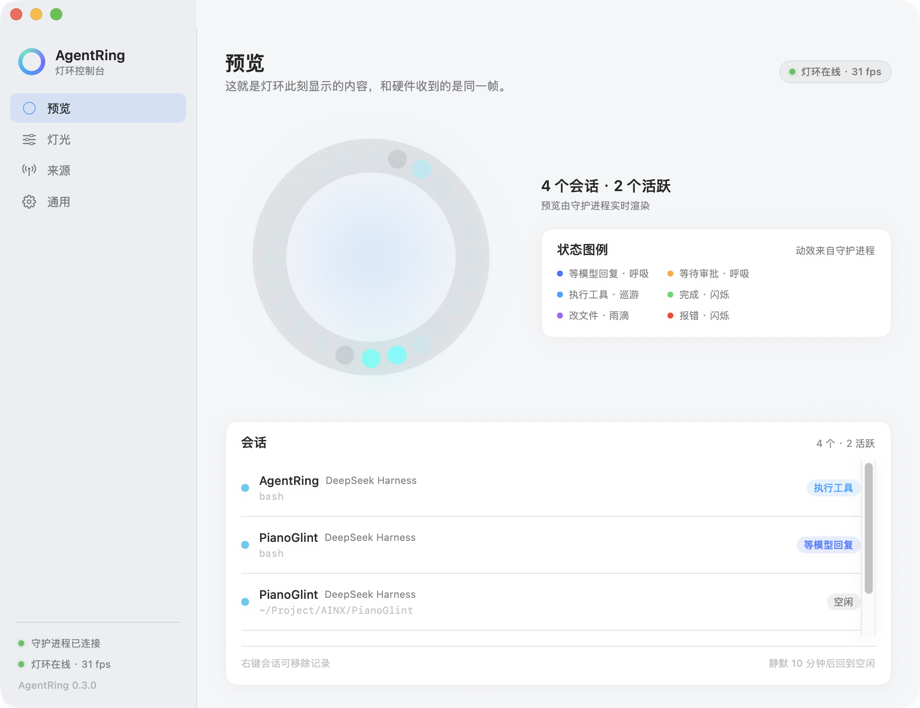
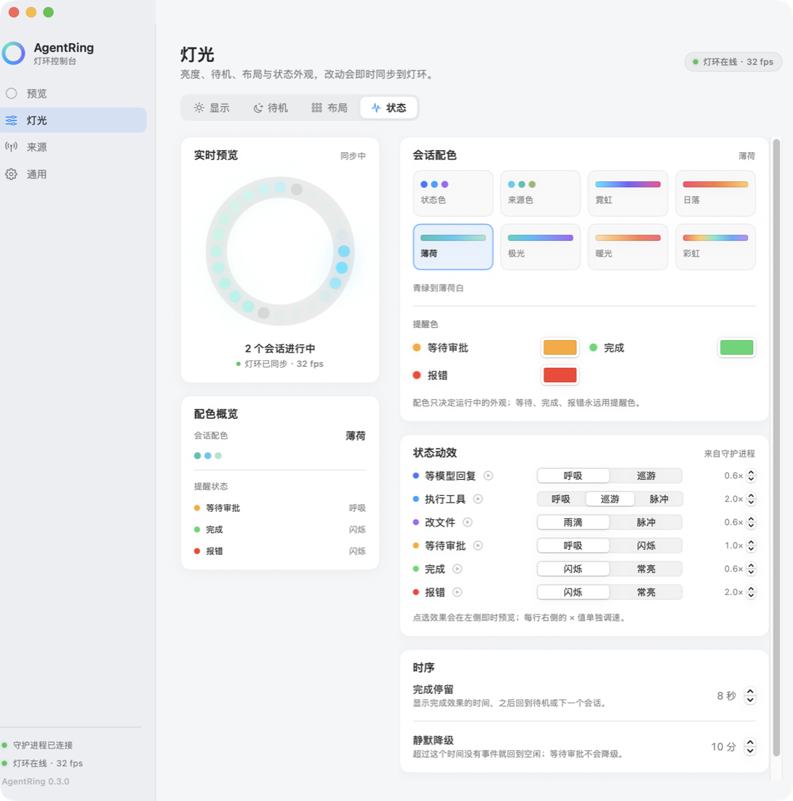
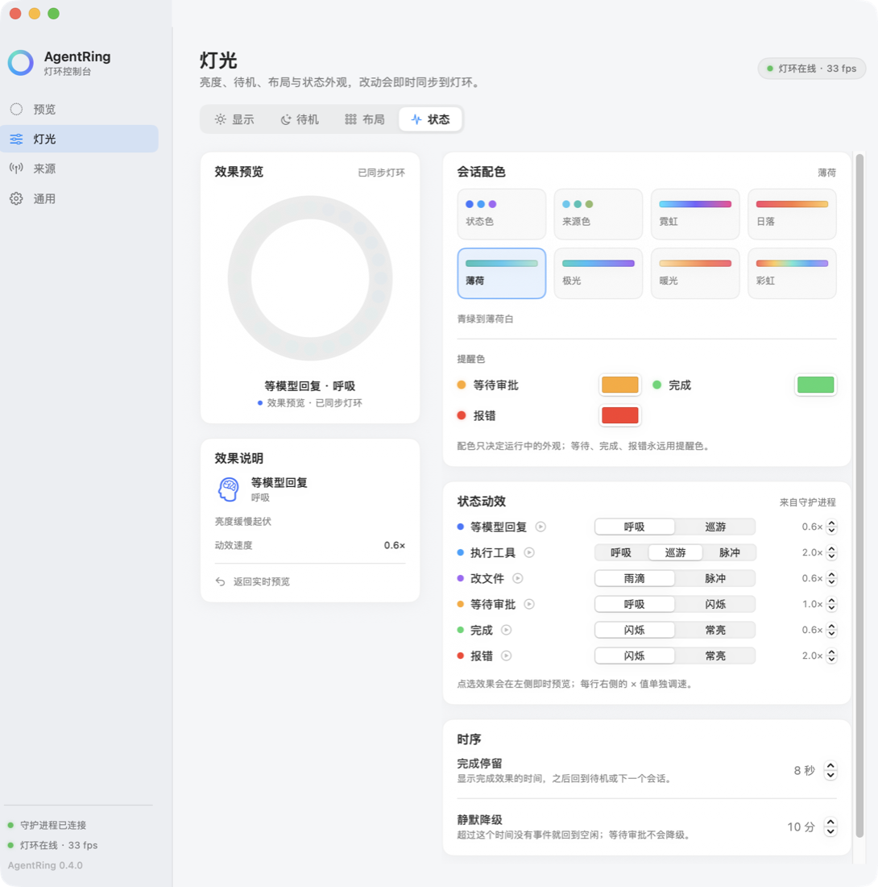

# 使用 AgentRing

[中文](usage.zh.md) · [English](usage.md)

本指南讲日常怎么用 App 和灯环。安装见[部署指南](installation.zh.md)；所有配置项和
HTTP 路由见[配置与 API](configuration.zh.md)。

## 菜单栏

AgentRing 是菜单栏工具，没有 Dock 图标。菜单栏项目显示：

- 非空闲会话的数量；
- 有会话等待审批时显示举手图标；
- 有会话报错时显示警告三角。

点开菜单可以打开设置窗口（`⌘,`）、查看最多五个会话及其状态、重启 daemon、打开浏览器
预览和退出 App。正常退出不会被 launchd 拉起；崩溃会被拉起。

## 设置窗口

四个页面，用 `⌘1`–`⌘4` 切换：

| 页面 | 快捷键 | 用途 |
|---|---|---|
| 预览 | `⌘1` | 灯环当前显示的内容，以及会话列表 |
| 灯光 | `⌘2` | 亮度、待机、布局和每个状态的外观 |
| 来源 | `⌘3` | 哪些 agent 已安装、已接入、会显示 |
| 通用 | `⌘4` | daemon/灯环诊断、维护和版本 |

侧边栏底部始终显示 daemon 是否已连接、物理灯环是否在收帧。

### 预览

灯环主视图由 daemon 的 `/frame` 字节渲染——和 ESP32 收到的是同一份字节。下面有：

- 会话总数和活跃数；
- 会话在等待或报错时的提醒标签；
- 六种状态及其当前动效的图例；
- 实时会话列表，每行显示标签、来源、状态和工具。

右键会话可以删除过期记录。页脚显示把安静会话降级为空闲的静默超时。会话按紧急程度
排序：`waiting > error > editing > tool > thinking > done > idle`。

### 灯光

左侧是实时灯环预览条，右侧是控件。预览条的概览卡片跟随当前选中的小节。

**显示**

- **亮度**：整体输出缩放（5–100%）。
- **伽马**：1.0 保留渲染器的原始亮度；数值越大，暗部越沉、渐隐越硬。
- **电流上限**：估算的 WS2812 电流超过这个上限时，渲染器会把整帧按比例压暗
  （300–2000 mA）。24 颗灯珠全白约 1.44 A。
- **夜间模式**：在本地时间的某个时间段内把亮度压到更低。

**待机**

没有会话运行时，那一颗灯珠怎么亮：

| 模式 | 行为 |
|---|---|
| 常亮单点 | 一颗不动的暗灯 |
| 巡游 | 一小段彗星尾巴绕着灯环慢慢转 |
| 随机呼吸 | 随机位置的一颗灯珠淡入淡出，与下一颗交叠 |

待机配色和会话配色相互独立：**单色** 使用下面的取色器，**霓虹 / 日落 / 薄荷 / 极光 /
暖光 / 彩虹** 是预设渐变。待机速度（0.2–3×）只影响待机，不影响会话动效。夜间模式
同样作用于待机。

**布局**

多个会话如何共享灯环：

- **等分**：每个会话一段。
- **聚焦最紧急**：只显示最紧急的会话。
- **轮播**：一次一个会话，每 3–60 秒切换。

`最多分段`（1–8）、`分段间隔`（0–3 颗不亮的灯珠）和 `空闲会话也占一段` 决定灯环
怎么分。空闲会话默认隐藏，除非打开这个开关。

**状态**

这里是颜色和动效交汇的地方。先选一套主配色，然后每个状态一行：

- **会话配色**：状态色 / 来源色 / 霓虹 / 日落 / 薄荷 / 极光 / 暖光 / 彩虹。
  它只决定**运行中**的样子。
- **状态色**（主配色选状态色时）：六个状态取色器。前三个是运行色；后三个同时也是
  提醒色。
- **提醒色**（主配色选其他配色时）：等待、完成和报错使用的三种颜色，不会被主配色
  覆盖。
- **状态动效**：每个状态的动效 + 速度（0.2–3×）。点状态名或选一个动效即可试听；
  预览见下文。
- **时序**：完成闪烁停留多久（2–30 秒），以及静默会话多久后降级为空闲（2–60 分钟）。
  等待不受静默超时影响。

只需要记住一条规则：**等待 / 完成 / 报错 始终使用提醒色**，无论主配色是什么。主配色
只改变忙碌时的样子。

#### 灯环上的动效预览

在 **状态** 里试听动效时，物理灯环会显示同一个合成帧：daemon 持有一个临时的预览
覆盖，并通过 `/frame` 和 TCP 帧流下发。预览条也读 `/frame`，所以屏幕和灯环不可能
不一致。这时卡片会显示“效果预览 · 已同步灯环”。

- 页面打开期间预览每 15 秒刷新一次，45 秒后过期。
- 点 **返回实时预览**、切换灯光小节，或关闭设置窗口，都会立即清除预览。
- 预览生效期间，灯环显示该状态而不是实时会话；离开预览即恢复。
- 如果 App 崩溃或被强杀，预览会在 45 秒内过期。

### 来源

每个支持的 agent 一行，带安装和接入状态：

| 状态 | 含义 |
|---|---|
| 已接入 | 工具和它的 AgentRing 接入都在 |
| 未接入 | 工具已安装，但 hook/插件缺失 |
| 未安装 | 这台 Mac 上没检测到该工具 |
| 未启用 | 插件已安装，但在其 profile 里未启用 |
| 配置不匹配 | 插件装在与运行工具不同的 profile 里 |
| 可手动接入 | 协议支持，但未注册安装器 |
| 状态未知 | daemon 离线，无法检测 |

每行显示工具版本、安装路径、运行中的 profile 和当前会话数。缺少接入时有两个操作：

- **一键接入** — 执行 AgentRing 自带的 Codex 或 Claude Code 安装器。它把 hook 合并
  进工具配置，保留其他 hook，写入带时间戳的备份，并且可重复执行。只有 AgentRing
  白名单里的脚本能这样执行；DSH 的包管理器命令只支持复制。
- **复制命令** — 同样的安装器，以终端命令形式给出，方便手动执行或 daemon 无法执行
  时使用。

开关决定该来源是否出现在灯环上。取色器设置工具颜色：在来源色主配色下它决定弧段颜色，
也是没有专用颜色的状态（比如空闲）的兜底色。主配色不是来源色时，它不驱动运行中的
弧段；页面副标题会说明这一点。

**其他来源** 列出已配置但不会自动检测的工具。它们仍可以通过 `/ingest` 接入
（见[其他 agent](installation.zh.md#其他-agent)）；事件一到就立即在灯环上生效。

### 通用

- **连接**：daemon 地址、灯环 IP、fps，以及重启 daemon 和打开浏览器预览的按钮。
- **语言**：界面在中文和 English 之间切换，也可以跟随系统。立即生效，只影响 App；
  daemon 和帧协议不变。
- **维护**：清除所有会话记录（agent 被强杀、没发结束事件时有用）。
- **关于**：App 版本、daemon 版本、硬件摘要、菜单栏行为。

## 状态、颜色与时序

| 状态 | 标签 | 何时出现 | 颜色行为 |
|---|---|---|---|
| `thinking` | 等模型回复 | 回合进行中，还没调用工具 | 主配色 |
| `tool` | 执行工具 | 有工具在运行 | 主配色 |
| `editing` | 改文件 | 编辑/写入类工具在运行 | 主配色 |
| `waiting` | 等待审批 | 等待审批或用户回答 | 提醒琥珀色，始终 |
| `done` | 完成 | 回合结束；停留 `完成停留` | 提醒绿色，始终 |
| `error` | 报错 | 回合/工具失败 | 提醒红色，始终 |
| `idle` | 空闲 | 会话存在，没有活跃回合 | 默认隐藏，暗色 |

灯环先给最紧急的会话分配空间。优先级是
`waiting > error > editing > tool > thinking > done > idle`。

两个超时保证灯环反映真实状态：

- 会话 `静默降级` 分钟内没有活动，就按空闲处理；等待不受影响；
- 结束的会话保留 `完成停留` 秒，然后转为空闲。

## 配色模型

从 AgentRing 0.3 起只有一套配色模型：

- `会话配色`（主配色）决定运行中的样子。**状态色** 用六个状态色；**来源色** 用各
  工具的颜色；**霓虹 / 日落 / 薄荷 / 极光 / 暖光** 是绕灯环铺开的预设渐变；
  **彩虹** 让色相环流动。
- **提醒色** 独立，等待/完成/报错时始终优先。
- **待机配色** 是另一套：单色，加上同样的预设渐变和彩虹。它只在没有会话显示时
  作用于灯环。

选一套配色只改这一个字段，永远不会重写颜色、速度或其他设置。渲染仍由 daemon 负责，
所以 App 预览、浏览器预览和硬件显示的永远是同一帧。

## 会话与菜单栏

菜单栏的数字是非空闲会话数。会话由 agent 接入上报，并自动过期：

- 刚结束的会话会短暂保留，避免 Codex 在两个回合之间闪烁；
- 空闲会话 45 分钟没有事件后消失；
- **通用 → 清除所有会话记录** 立即清掉过期记录。

在 **预览** 里用右键菜单删除单条记录。不会删除 agent 自身的任何东西。

## 快捷键

| 快捷键 | 操作 |
|---|---|
| `⌘1` / `⌘2` / `⌘3` / `⌘4` | 预览 / 灯光 / 来源 / 通用 |
| `⌘,` | 打开设置窗口 |

## 配置与重置

设置存在 `~/.agentring/config.json`（v3）。daemon 是唯一事实来源，每次更新都会做校验
清洗。灯光页底部的 **恢复默认灯光设置…** 链接可以恢复默认配色、布局、动效和来源
列表；它覆盖显示、布局、动效、颜色和来源，不涉及 agent hook。

从 0.2.x 升级时，daemon 启动会把旧的 theme/colour-mode 配置迁移到 v3，并只改写一次
文件。如果你自定义过颜色，跨小版本升级前先备份 `~/.agentring/config.json`。

## 常见问题

**我换了配色，等待/完成/报错却没变。**
它们有意保留提醒色；主配色只影响运行中的会话（空闲灯环用的是自己的待机配色）。

**灯环显示的是动效，不是我的会话。**
**灯光 → 状态** 的预览还开着。点 **返回实时预览**、切换小节、关闭窗口，或等 45 秒。

**Codex 的会话不出现。**
打开 **来源**；Codex 应该是 **已接入**。Codex 会问一次是否信任 hook；云端任务不在本地
运行，不会触发本地 hook。

**Claude 会话从来不显示 报错。**
对 Claude Code 重新执行 **一键接入**（或 `npm run install:claude`）。安装器会加上
`StopFailure` hook，它驱动红色报错态；0.3.0 之前的安装只有七个生命周期事件。

**App 说灯环未连接。**
看 `/health` 的 `streamClients: 1` 和持续增长的 `streamFrames`；在 Mac 防火墙放行
TCP 7802 和 mDNS；确认灯环和 Mac 在同一网段，或在 `config.h` 里设置
`AGENTRING_HOST`。

**什么都不亮。**
检查 5 V 供电和共地，确认 DIN 接在 GPIO10，然后用 115200 串口执行 `info`。见
[硬件](hardware.zh.md)。
