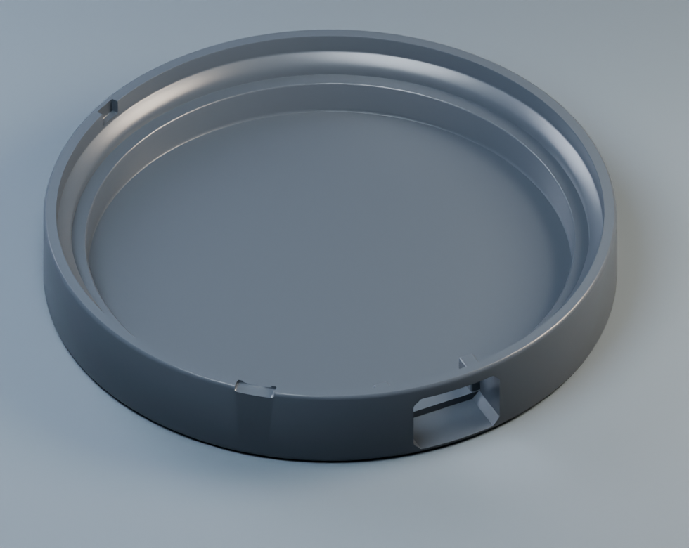

# Enclosure

[中文](README.zh.md) · [English](README.md)

A printable enclosure for the 24-LED ring and its ESP32-C3 board.

| Version | Path | USB-C opening |
|---|---|---|
| V2 (current) | `enclosure/v2/` | 12.0 × 8.2 mm, C1 chamfer, anti-rotation ribs |
| V1 | `enclosure/` | 14.0 × 6.2 mm |

Each folder contains the three print-ready STLs (base, diffuser, center), the
Blender source (`*.blend`), a preview render, a zipped bundle and print/assembly
notes (`打印与装配.txt` in Chinese, `Printing and Assembly.txt` in English). `build_enclosure.py` regenerates the model in
Blender.

The diffuser should be printed in a translucent material; the base and center
can use PLA or PETG. The STLs are in millimetres and already oriented for
printing at 100% scale. The model expects a 64 mm ring board, 1.6 mm thick, with
6.5 mm from the PCB to the top of the USB-C shell.

