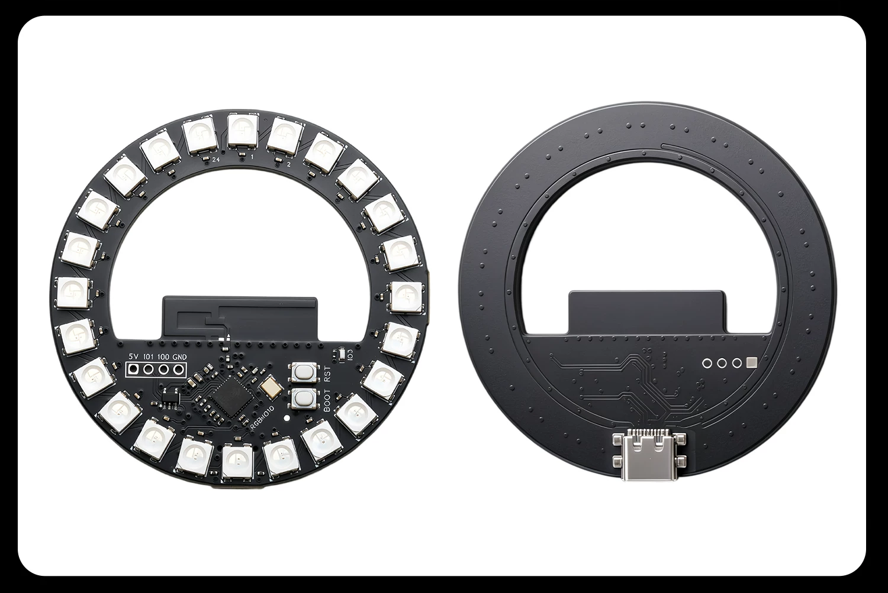
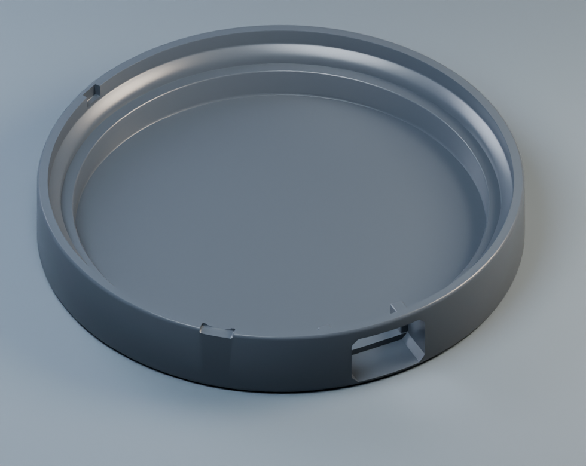

# 外壳

[中文](README.zh.md) · [English](README.md)

24 颗灯珠的灯环及其 ESP32-C3 板子的可打印外壳。

| 版本 | 路径 | USB-C 开口 |
|---|---|---|
| V2（当前） | `enclosure/v2/` | 12.0 × 8.2 mm，C1 倒角，防转凸筋 |
| V1 | `enclosure/` | 14.0 × 6.2 mm |

## 照片

24 颗 WS2812B 灯环、ESP32-C3 板与 USB-C 接口：灯珠面与背面。
更多：[竖排正反面](photos/ring-front-back-vertical.webp) ·
[PCB 尺寸标注](photos/ring-dimensions.webp)。

每个目录包含三个可直接打印的 STL（底座、柔光罩、中心件）、Blender 源文件（`*.blend`）、
一张预览渲染图、一个压缩包，以及打印/装配说明（中文 `打印与装配.txt`，英文 `Printing and Assembly.txt`）。`build_enclosure.py`
可在 Blender 中重新生成模型。

柔光罩建议用半透明材料打印；底座和中心件可用 PLA 或 PETG。STL 单位为毫米，并且已经按
100% 比例摆好打印方向。模型对应 64 mm 的灯环板、板厚 1.6 mm，PCB 到 USB-C 壳顶为 6.5 mm。

